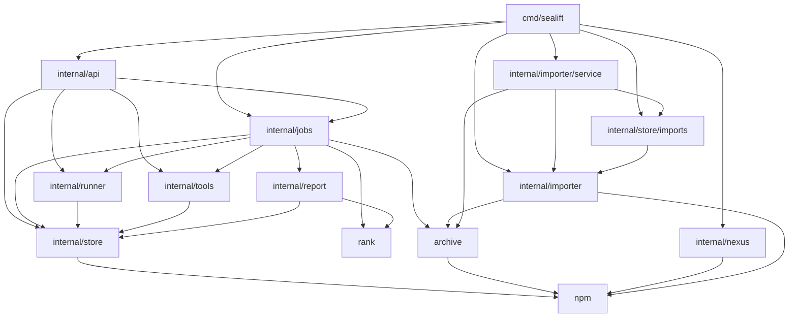

# Contributor guide

This page is for anyone about to change sealift's code, contributors human or automated. It shows where things live, how to run and test them, how a change is made here, and which design choices a change must keep. [Contributing](../../CONTRIBUTING.md) is the short entry point; [Architecture](architecture.md) explains the analysis and export in depth.

## Repository map

| Path | Holds |
| --- | --- |
| `cmd/sealift/` | The only `main` package: flags, startup, the HTTP server, and the `import` and `import-server` subcommands |
| `api/` | `openapi.yaml` (the collection API), `import.yaml` (the import service API) and the `oapi-codegen` configs |
| `internal/` | The server's packages, listed below |
| `archive/` | The reproducible `tar.gz` writer, the `manifest.json` parser and the archive verifier the import runs |
| `npm/` | `package.json` validation, the registry client, pnpm lockfile reading, version order, the platform filter, tarball reading |
| `rank/` | CVE vectors, signals and the choice of the best candidate |
| `sbom/` | The CycloneDX writer |
| `web/` | The React interface, and `embed.go`, which embeds its build into the binary |
| `test/e2e/` | The end-to-end test: sealift, two Verdaccio registries and a test runner in Compose |
| `charts/` | The Helm chart of the import service and its render tests in Go, which run the `helm` binary |
| `deploy/` | The Compose file of the collection role and the Argo CD examples, with their tests |
| `lab/` | A local copy of both sides of the air gap: sealift, Nexus, MinIO, Keycloak, oauth2-proxy and a gateway |
| `docs/` | User and developer documentation |
| `scripts/` | `check-docs.mjs`, the link, anchor and runnable-example check for Markdown |
| `githooks/` | The versioned pre-commit hook that `just hooks` links |
| `.github/` | The `ci` and `image` workflows, the issue templates and the pull request template |
| `Dockerfile`, `docker-entrypoint.sh` | The image: build stages, the `app` and `tools` users, file capabilities, the entrypoint that picks the import roles' binary |
| `justfile` | The shortcuts for every command on this page |

The Go packages under `internal/`:

| Package | Role |
| --- | --- |
| `internal/api` | Handlers for the strict server generated from `api/openapi.yaml`, problem responses, the event stream, the static file server |
| `internal/jobs` | `Service`, `Queue`, the analysis and the export |
| `internal/store` | Every read and write of the `/data` volume, and settings validation |
| `internal/store/imports` | The records of each import and its attempts, one folder per user |
| `internal/tools` | Installing Trivy and pnpm, with hash checks |
| `internal/runner` | Running pnpm and Trivy as subprocesses, as the tools user, in their own process group |
| `internal/report` | `manifest.json`, `summary.md` and `findings.csv` |
| `internal/nexus` | The client for a Nexus 3 hosted npm repository |
| `internal/importer` | The import run: checks an archive, publishes each package through a `Publisher`, builds the report; also loads the import settings file |
| `internal/importer/service` | The import service's handlers for the strict server generated from `api/import.yaml`, the token middleware, the screens |
| `internal/importer/token` | Checks an access token against a realm's signing keys |
| `internal/importer/s3` | A small MinIO client that lists, heads, reads and deletes objects, and never writes one |

The web app has two entries, built apart:

| Entry | Source | Built to | Served by |
| --- | --- | --- | --- |
| Collection screens: setup, home, settings, and a session's drop, analysis, review and export | `web/index.html`, `web/src/routes/`, `web/src/components/` | `web/dist/app` | `sealift` |
| Import screens: Archives, Imports and one import | `web/import/index.html`, `web/src/import/`, `web/src/components/import/` | `web/dist/import` | `sealift import-server` |

## How the Go packages depend on each other

Arrows follow the imports of the non-test code. `rank` and `npm` import no sealift package, and `internal/importer/token` and `internal/importer/s3` import none either.



The diagram leaves out three packages and some edges to keep it readable:

- `sbom` is imported by `internal/jobs` only.
- `internal/importer/token` and `internal/importer/s3` are imported by `internal/importer/service` and `cmd/sealift`.
- `cmd/sealift` also imports `internal/store`, `internal/tools`, `internal/runner`, `npm` and `web`.
- `internal/api`, `internal/jobs`, `internal/runner` and `internal/tools` import `npm` as well.

`internal/importer` does not import `internal/nexus`. `cmd/sealift` passes the Nexus client in through the `Publisher` interface, so the import logic is tested against a fake.

## Set up and run

### Requirements

| Tool | Version | Source |
| --- | --- | --- |
| Go | 1.27 | `go.mod` |
| Node | 22 | `engines` in `web/package.json` |
| pnpm | 12.3.4 | `packageManager` in `web/package.json`; `corepack enable` selects it |
| [just](https://just.systems) | any | `justfile` |
| golangci-lint | 2.15 | `ci.yml` pins v2.15.0; `.golangci.yml` is its config |
| Docker | any with buildx | the image, the end-to-end test and the lab |
| Trivy | on your `PATH` | the integration tests only |
| Chromium for Playwright | `pnpm -C web exec playwright install chromium` | the browser gate only |

sealift installs its own pnpm, 10.34.5 by default, into the data volume to resolve projects. That one is unrelated to the pnpm that builds the web app.

### The just recipes

`just` with no argument lists them.

| Recipe | What it does |
| --- | --- |
| `just hooks` | Links `githooks/pre-commit` into `.git/hooks`. The hook runs gofmt, `go vet`, golangci-lint and `go test -race ./...` before each commit |
| `just check` | `fmt-check`, `vet`, `lint` and `test`: the Go checks CI runs |
| `just fmt-check` | Fails when `gofmt -l .` lists a file |
| `just vet` | `go vet ./...` |
| `just lint` | `golangci-lint run ./...` |
| `just test` | `go test -race ./...` |
| `just bench` | The benchmarks, without the tests |
| `just generate` | Regenerates the Go servers and the web types from the two contracts |
| `just integration` | `go test -tags integration -race ./...` |
| `just image` | Builds `sealift:dev` for the host's architecture and loads it into Docker |
| `just image-check` | Builds for `linux/amd64` and `linux/arm64` without loading, to check the Dockerfile cross-builds |
| `just e2e` | Runs the end-to-end test in Compose, then removes it |
| `just web-dev` | The Vite dev server |
| `just web-check` | Typecheck, ESLint and Vitest on the web app |
| `just web-build` | The production build of both web entries |
| `just docs` | The Markdown check: its own tests, then every link, anchor and block |
| `just chart` | `helm lint --strict` and the chart's render tests; needs Helm, and fails without it when `SEALIFT_CHART=1` |

### Run the server

A fresh clone builds without Node: `web/dist/index.html` is a tracked placeholder, which `web/embed.go` embeds until `just web-build` writes the real build beside it, to `web/dist/app` and `web/dist/import`.

```sh
go run ./cmd/sealift -addr 127.0.0.1:8080 -data "$(mktemp -d)"
```

The first run shows the setup screen, which downloads Trivy and its database into the data directory. Outside the image, sealift runs pnpm and Trivy as your own user. The switch to a separate `tools` user happens only when `SEALIFT_TOOLS_UID` and `SEALIFT_TOOLS_GID` are set, as the image does. `SEALIFT_NPM_REGISTRY` points the registry client at another registry, which the end-to-end test uses.

### Run the web dev server

```sh
pnpm -C web install
just web-dev
```

Vite proxies `/api` to `127.0.0.1:8080`. `SEALIFT_API` points it elsewhere. The collection entry is the only one this serves. The import entry needs a gateway and a signed-in user, so check it on the lab or with the browser gate.

### Run the lab

The lab runs both sides of the air gap on one machine. Nexus needs about 2 GB of memory, so give Docker at least 6 GB.

```sh
just image
cd lab
SEALIFT_IMAGE=sealift:dev docker compose up -d
./setup.sh
```

[`lab/README.md`](../../lab/README.md) lists the addresses and logins, the checks that the air-gapped network has no route out, and the protocol for carrying an archive across through `lab/transfer/`.

## Tests

### Go unit tests

`go test -race ./...` runs every test without the `integration` tag. Tests sit beside the code they cover, in `_test.go` files.

- Network clients are tested against `httptest` servers, such as the registry client in `npm/registry_test.go`.
- The import side has fakes for its dependencies: `internal/importer/fakenexus_test.go` stands in for Nexus.
- Fixtures live in `testdata/` folders: `rank/testdata/trivy-report.json`, `npm/testdata/`, and the stored import records of earlier releases in `internal/store/imports/testdata/`.
- `archive/example_test.go` holds an `Example` function.
- `cmd/sealift` has two package-level hooks, `onQueueReady` and `onImportListen`, that only tests set, to reach a server before it accepts connections.
- A test that depends on running as, or not as, root skips with a message.

### Integration tests

`just integration` adds the `integration` build tag. The tests are in `internal/runner/`:

| File | Needs | Without it |
| --- | --- | --- |
| `tooling_integration_test.go` | Node on `PATH` and network for the real pnpm, which `tools.Manager` downloads. A second test needs `trivy` on `PATH` and network for its database | Skips with a message |
| `capabilities_integration_test.go` | `SEALIFT_TOOLS_UID` and `SEALIFT_TOOLS_GID` set, which means running inside the image as `app` | Skips with a message |

The `ci` workflow runs the tagged tests on both architectures, after installing Node 22 and Trivy.

### Web unit tests

`pnpm -C web run test` runs Vitest with jsdom over `web/src/**/*.test.{ts,tsx}`. Tests sit next to the file they cover, and `web/src/test/setup.ts` is the shared setup. Pure logic has its own tests, such as `web/src/lib/sessionSteps.test.ts` for the step bar. The browser gate lives in `web/tests/` and is excluded from this run.

### The browser gate

`web/tests/ui-gate.spec.mjs` loads each route in Chromium at 1024 and 1280 px, in light and dark. A page fails on a serious or critical axe finding, on horizontal overflow, on a visible control under 32 px, and when the dark theme looks the same as the light one. Each failure names the route, width, theme and selector.

The run builds the web app and one `sealift` binary, then starts both roles from it: the collection on port 18080 over a data directory that `web/tests/seed.mjs` writes, and the import server on port 18090 behind a real token check, fed by `web/tests/import-fixtures.mjs`. The gate stops with an error when something already answers on 18090. CI does not run it, so run it yourself when a screen changes:

```sh
pnpm -C web exec playwright install chromium
pnpm -C web exec playwright test tests/ui-gate.spec.mjs
```

On every import route the gate also fails when the page calls a collection route (`/api/projects`, `/api/settings`, `/api/tools`, `/api/jobs`) or the browser reports a Content-Security-Policy violation. [Web](web.md#checks) lists the users and the states the import fixtures give them.

To add a screen to the gate:

1. A collection route: add its path to `UI.routes` in the spec. A session route needs data, so extend `web/tests/seed.mjs`, which writes the same files `internal/store` reads back.
2. An import route: add an entry to `IMPORT.routes` with the `path`, the `user` whose token the page sends, and `ready`, the text that proves the data arrived. Add `open` to press a control before the checks, and `hold` to keep an API path pending so the loading state shows.
3. A new import state needs a record in `web/tests/import-fixtures.mjs` and an id in its `IDS`.
4. Wait for text, never for network idle: the event stream keeps the network busy.
5. Fix a failure in the screen. `UI.exceptions` lifts a check for one selector, with a reason. It holds one entry today, Radix's focus-trap sentinel.

### The end-to-end test

`just e2e` builds the image from the `Dockerfile` and starts it in `test/e2e/docker-compose.yml` beside two Verdaccio registries: one standing in for the public registry, one with no uplink standing in for the air-gapped side. `test/e2e/run.mjs` drives sealift through its HTTP API: it installs Trivy, creates a project from `test/e2e/project/package.json`, follows the analysis, exports, downloads the archive, publishes it to the registry without an uplink and installs the project from there with pnpm. `test/e2e/run.sh` then runs every `sh` block in `docs/` that carries a `<!-- run -->` marker against the same sealift, with `<!-- expect: text -->` markers for the output that must appear.

### Mutation testing

The repository has no mutation-testing setup. A new test should still fail for the right reason: check that it fails before the fix it covers.

## The checks CI runs

`.github/workflows/ci.yml` runs on every pull request and on pushes to `main`:

| Job | Runs | Local equivalent |
| --- | --- | --- |
| `go`, on amd64 and arm64 | gofmt, `go vet`, golangci-lint v2.15.0, `go test -race ./...` | `just check` |
| `integration`, on amd64 and arm64 | `go test -tags integration -race ./...` with Node 22 and Trivy installed | `just integration` |
| `web` | `pnpm install --frozen-lockfile`, typecheck, lint, tests, the docs check, the production build | `just web-check`, `just docs`, `just web-build` |
| `e2e`, on amd64 and arm64 | The Compose end-to-end test | `just e2e` |
| `chart` | `helm lint --strict` and the render tests of `charts/`, with Helm 3.22.1; the tests fail instead of skipping | `just chart` |

`.github/workflows/image.yml` builds the image on pushes to `main`, on version tags and on pull requests. A smoke test first builds it natively, starts it, calls `/healthz`, and checks the `app` user, that the `tools` user can write to `/data` but cannot read `/data/private/settings.json`, and that `HOME` exists. It then builds each architecture on its own runner. Only pushes and tags publish, and a `v` tag adds the version and `latest` tags to the manifest.

Before you open a pull request, run `just check`, `just web-check`, `just docs`, and `just web-build` if you touched the web. Add `just integration` when you touched `internal/runner` or `internal/tools`, `just e2e` for a change to the analysis, the export or the image, and the browser gate for a change to a screen. The pre-commit hook covers the Go checks only.

## How a change is made

### Commits

- [Conventional Commits](https://www.conventionalcommits.org/en/v1.0.0/): `type(scope): subject`, with the types `feat`, `fix`, `docs`, `test`, `refactor`, `perf`, `build`, `ci` and `chore`.
- The scope names a package or an area, such as `fix(web): ...` or `feat(import): ...`. Drop it when the change spans the repository.
- The subject is imperative, lowercase, without a trailing period. Every line of the message, subject and body, is at most 72 characters.
- The body explains why. The diff shows what.
- Trailers are `Fixes #N` or `Refs #N` and nothing else.
- One logical change per commit. Each commit builds and passes the tests on its own, so a test goes in the commit that makes it pass.
- A breaking change takes `!` after the type and a `BREAKING CHANGE:` footer.

A pull request body is plain paragraphs: what changed, why, and how you tested it. `CHANGELOG.md` follows Keep a Changelog; add an entry under `Unreleased` for anything a user notices.

### The contracts and their generated code

`api/openapi.yaml` describes the collection API and `api/import.yaml` the import service's. Both are the source of truth. After editing either, run `just generate`. It runs `oapi-codegen` v2.8.0 with `go run`, so it needs the module cache or network, then runs `pnpm -C web run generate`. It writes four files, which you commit with the contract change:

| File | From |
| --- | --- |
| `internal/api/api.gen.go` | `api/openapi.yaml`, with `api/oapi-codegen.yaml` |
| `internal/importer/service/api.gen.go` | `api/import.yaml`, with `api/oapi-codegen-import.yaml` |
| `web/src/api/schema.d.ts` | `api/openapi.yaml` |
| `web/src/import/api/schema.d.ts` | `api/import.yaml` |

Never edit them by hand. The server code comes from the `strict-server` generator, so a new operation adds a method to `StrictServerInterface` and the build fails until `Handlers` implements it. The two `routeTree.gen.ts` files, `web/src/routeTree.gen.ts` and `web/src/import/routeTree.gen.ts`, are tracked too. The TanStack Router plugin rewrites them when Vite runs, so commit them with a new or renamed route file.

### Web style

The web code has no Prettier config. Never run `prettier` on it: it would add semicolons. Match the surrounding style by hand: no semicolons, double quotes, long lines. No tool enforces this style, so check it by eye in the diff.

### Comments and errors

- A comment gives a reason the code cannot show: a constraint, a workaround, a known limit. It never restates the line below.
- Doc comments go on exported symbols only, one sentence when one sentence covers it.
- Names come from the domain: `Queue` over `QueueManager`.
- No commented-out code, and no `TODO` without an issue number.
- Handle errors at trust boundaries and on paths that can lose data: input from a request, a registry, an archive, MinIO, Nexus or the file system. Do not wrap a call in a blanket catch that only logs.
- Error messages are for the person reading them. They name what failed and what to do, and they do not repeat untrusted input without bounding and cleaning it, as `cleanText` and `minioText` do in `internal/importer/service`.

### Prose

Documentation, error messages, comments and commit messages use short declarative sentences in the active voice. No emoji, no em dashes, no exclamation marks. A heading names what the section holds. `just docs` checks links and anchors.

## Design choices to keep

Each choice below has a reason that a change can undo by accident. If a change needs to break one, say so in the pull request and update this page.

### One binary, two roles

The collection role and the import role are the same program. `cmd/sealift/main.go` picks the role from the first argument: none starts the server, `import` imports one archive from a file, and `import-server` serves the import service. One build gives one set of tests, one version to stamp and one image to ship to both sides of the air gap.

The roles do not run the same way. The `Dockerfile` copies the binary twice. `/usr/local/bin/sealift` carries the file capabilities `cap_setuid`, `cap_setgid` and `cap_kill`, which the collection role needs to start pnpm and Trivy as `tools` and to cancel their process groups. `/usr/local/bin/sealift-import` carries none. `docker-entrypoint.sh` sends `sealift import` and `sealift import-server` to the second copy, so the role that parses untrusted archives can run under `--cap-drop ALL`. Keep any code the import role needs out of the capability-dependent paths.

### The import role serves only its own contract and screens

`sealift import-server` answers `/healthz`, the routes of `api/import.yaml` under `/api` behind the token check, and its own screens. Every other path is a 404. It never serves a collection route or the collection's build: `web.ImportScreens()` returns `dist/import` or a bare placeholder, never `dist/app`.

The boundary holds in the code, so keep it there:

- `internal/importer`, `internal/importer/service`, `internal/importer/token`, `internal/importer/s3` and `internal/store/imports` import no collection package: not `internal/api`, `internal/jobs`, `internal/runner`, `internal/tools` or `internal/store`.
- ESLint refuses an import of the collection's API client, routes or session, settings and project components from `web/src/import/` and `web/src/components/import/`, and refuses `dangerouslySetInnerHTML`. Text from an archive, MinIO or Nexus renders as a text node.
- `web/src/import/api/client.ts` refuses a path outside the import contract before it sends a request, and the browser gate fails an import page that calls a collection route.

The reason is the air-gapped side, where other users share the network and the import role handles untrusted archives and tokens. Its reachable surface stays as small as its contract.

### The export is a function of the stored analysis

An export reads the lockfiles the analysis wrote and the selection it received. It resolves nothing new: `packageList` in `internal/jobs/export.go` merges the stored lockfiles of the selected versions, and `ValidateSelection` refuses a version the analysis never resolved. `archive.WriteTarGz` sorts entries, sets every timestamp to the Unix epoch and every owner to 0.

The same selection from the same analysis therefore gives the same bytes and the same sha256. An operator checks that digest after the archive crosses the kiosk, and a second export of the same selection must match the first. A live registry query, a clock value or an unordered map in the archive or the package list breaks this. `manifest.json` carries the time of the export because it travels beside the archive, outside the hash.

### Stored data has no migrations

Nothing rewrites data on the volume when sealift upgrades. A newer sealift reads what an older one wrote, and an older record stays readable for as long as its release has been published.

- A new field is optional. Records use `omitempty` and pointers, so a record without the field reads as "not recorded". `Report.ArchiveChecked` in `internal/importer/report.go` is a `*bool` for this reason.
- `internal/store.Open` loads `private/settings.json` as written and fills no defaults, so a setting added later reads as its zero value until someone saves. Choose a zero value that keeps the old behavior, or check for it where the value is used.
- Import records carry `FormatVersion`, and `manifest.json` carries `formatVersion`. Raise a version only when the meaning of a field changes in a way an older reader would misread. Do not raise it to add a field.
- Keep a fixture of each shape a release has written, as `internal/store/imports/testdata/import-v0.4.0-incomplete.json` does, and test that it reads and that rewriting it adds no `null`.
- The interface shows an absent value in words, as in `Not recorded`, and does not invent one.

### Least privilege on the air-gapped side

Each part gets the access it needs and no more:

- pnpm and Trivy run as the `tools` user. `private/settings.json` is mode 0600 and readable by `app` only, so the tools cannot read the settings.
- The import binary has no capability, and the image runs as `app`, not root. The import roles are built to run under `--cap-drop ALL`, which the operator sets in the Compose file or `docker run`.
- `internal/importer/s3` can list, head, read and delete, and has no call that writes an object. Deletion happens only after a complete import, and only when the archive and manifest still carry the ETag the import recorded.
- The import service reads the token from one header, the one `token.header` names (`X-Access-Token` by default), and takes the user from the checked claims through the request context and from nowhere else. A user sees only their own folder in MinIO and their own imports.
- The Nexus account the import publishes with, in `lab/`, may read, browse, add and edit in the `npm` repository and upload components, and nothing else. The import never overwrites a version Nexus holds with other bytes.

### Never report success for work that did not happen

A state, a count or a message says what happened, and an uncertain outcome gets its own state.

- An import package is `published` only after sealift reads the upload back from Nexus and the bytes match the shipped sha512. Otherwise it is `failed`, with a kind.
- An import checks the whole archive against its manifest before it publishes anything. A refused archive publishes nothing, and its report holds zero counts with `archiveChecked` false.
- A job cut short by a restart is `interrupted`, not `failed` and not `done`. Both servers mark what a restart interrupted at startup, before the first request.
- A complete import is stored before its archive is removed from MinIO, and a removal that did not happen records why.
- An export stops with `ErrTampered` when a downloaded tarball does not match its recorded integrity. A candidate that does not resolve gets the `does-not-resolve` signal, and the analysis records it.
- Warnings the user must see, such as a failed database refresh, stay in the result and reach the screen, not only the log.

When a change adds an outcome, give it a state and a message of its own, and add the screen words that go with it.

## Where to add things

### A collection API route

1. Describe the path, the operation, its request and response, and its problem responses in `api/openapi.yaml`.
2. Run `just generate`.
3. Implement the new method on `Handlers`, in the matching `internal/api/handlers_*.go` file. Return failures through `problem` or `autoProblem`. Keep the handler thin: logic that touches jobs goes through `jobs.Service`, and logic that touches the volume goes in `internal/store`.
4. Add a client function in `web/src/api/` if the interface calls it.
5. Add tests: a handler test in `internal/api/` (`handlers_test.go`, `server_test.go`), a unit test for the logic in the package that holds it, and a client test in `web/src/api/client.test.ts` when the client changes.
6. Update `docs/dev/api.md` with the route, its statuses and, where it is safe to run against a fresh server, a `<!-- run -->` block. Add the message to `docs/troubleshooting.md` when it is new, and an entry to `CHANGELOG.md`.

A route for the import service follows the same steps with `api/import.yaml`, `internal/importer/service/` and `web/src/import/api/`. The method set on `Handlers` there is the import contract's.

### A collection screen

1. Add a file to `web/src/routes/`, named for the path with dots, as in `sessions.$sessionId.review.tsx`. Commit the regenerated `web/src/routeTree.gen.ts`.
2. Put the screen's components in `web/src/components/session/`, or the folder that fits. Keep pure logic in `web/src/lib/` so it tests without a DOM.
3. If the screen is a step of a session, extend `web/src/lib/sessionSteps.ts` and its test: every route renders the step bar from that one function.
4. Add component tests beside the files, and add the route to `UI.routes` in the browser gate, with seed data if it needs a session.
5. Drive the screen in a real browser against a real server, in the running, failed and reloaded states and in both themes, as [Web](web.md#checking-a-screen-in-a-browser) describes.
6. Re-read the pages that quote the screen's words, which the table in [Contributing](../../CONTRIBUTING.md#changing-the-interface) lists, and retake the screenshots in `docs/assets/` if the screen changed.

### An import screen

Use `web/src/import/routes/` for the route, `web/src/components/import/` for components and `web/src/import/api/` for the client. Import only what the ESLint boundary allows. A new call must also pass the `CONTRACT` pattern and the path type of `importFetch` in `web/src/import/api/client.ts`. Add a route to `IMPORT.routes` in the gate and a record to `web/tests/import-fixtures.mjs` for any state it shows. Check it on the lab with `SEALIFT_IMAGE=sealift:dev`, as [Web](web.md#the-import-screens) lists. Update `docs/importing.md` and `docs/air-gap.md`.

### A setting

1. Add the field to `Settings` in `internal/store/types.go`, its default to `defaultSettings` and its range check to `internal/store/store.go`.
2. Add it to the `Settings` schema in `api/openapi.yaml`, then run `just generate`.
3. Carry it through `UpdateSettings` and `settingsToAPI` in `internal/api/handlers_settings.go`. `PUT /api/settings` replaces every field, so a field left out of `UpdateSettings` is saved as its zero value.
4. Use the value where it applies. A running job keeps the values it started with.
5. Add it to the form in `web/src/components/settings/settings-form.tsx`, with its range and its error text, and extend `settings-form.test.tsx`.
6. Account for a `settings.json` written before the field existed (see "Stored data has no migrations" above) and test it in `internal/store/store_test.go`.
7. Update `docs/settings.md` and the defaults line of `llms.txt`.

### An import check

Where the check goes depends on what it reads:

| Check on | Goes in | Tests in |
| --- | --- | --- |
| The manifest's fields | `checkManifest` and `checkPackage` in `archive/manifest.go` | `archive/manifest_test.go` |
| The archive's entries, sizes or digests | `scan` and its helpers in `archive/verify.go` | `archive/verify_test.go` |
| One package's tarball or its state in Nexus | `publishOne` and its helpers in `internal/importer/publish.go` | `internal/importer/publish_test.go`, against `fakenexus_test.go` |

`sealift import` and `sealift import-server` share these functions, so one change covers both. The first problem found ends the run with its reason, and a wrong size or sha256 is named before any other. A refusal names what failed and repeats no untrusted value in full.

When the check adds a failure kind, add it to `Kind` in `internal/importer/publish.go`, to the `kind` enum in `api/import.yaml` (then `just generate`), and to `web/src/import/lib/kinds.ts` with its words and test. A kind this version of the screens does not know gets a general message, so older screens keep working. A check that changes what an older import would accept bumps `formatVersion` and says so in `docs/dev/archive-format.md`. Update that page's check list, `docs/importing.md`, `docs/air-gap.md` and `docs/troubleshooting.md`, and add a case for it to the lab's protocol in `lab/README.md` if it needs a planted fault.
