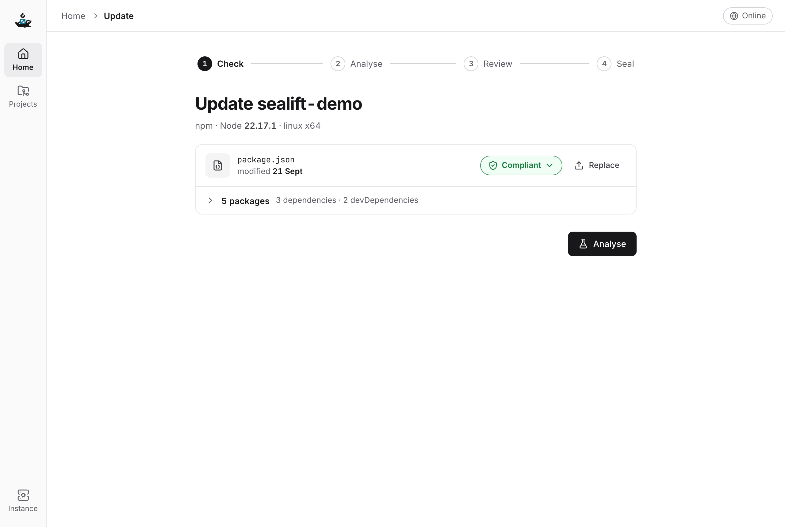
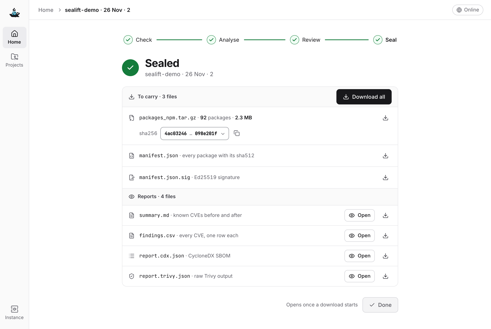

# Getting started

This page takes you from nothing to a first archive in about ten minutes. It uses a five-dependency project with known CVEs, so every screen has something to show.

## Requirements

- Docker on a machine with outbound HTTPS to GitHub (Trivy), `mirror.gcr.io` (its vulnerability database), `registry.npmjs.org` (pnpm and packages) and `pypi.org` with `files.pythonhosted.org` (uv). [Deployment](deployment.md#outbound-access) lists the hosts.
- About 2 GB of free disk for Trivy, its database, pnpm, uv and the package cache.

sealift runs on the connected side of your network. Only the archive it builds, its `manifest.json` and the manifest's signature, `manifest.json.sig`, need to cross to the air-gapped side.

## 1. Run it

```sh
docker run -d \
  --name sealift \
  -p 127.0.0.1:8080:8080 \
  -v sealift-data:/data \
  ghcr.io/morgankryze/sealift:latest
```

`127.0.0.1:8080` keeps the interface on this machine. The `sealift-data` volume holds every session, archive and setting, and survives an upgrade. [Deployment](deployment.md) covers Compose, a reverse proxy and backups.

## 2. Wait for the preparation

On its first start, sealift downloads what an analysis needs, with no click: Trivy 0.76.2, the release its binary pins, checked against the sha256 built into sealift; Trivy's vulnerability database, about 120 MB (1.4 GB once unpacked); pnpm 10.34.5; and uv 0.13.7. It also generates an Ed25519 signing key for this volume.

Open <http://localhost:8080>. Until every item is ready, the page shows Preparing sealift, with each item and its state: Preparing, Ready or Failed. A failed item shows its cause and the time of its next try, and sealift tries again every minute. The home opens by itself once every item is ready. In the lab, at commit 0257b72, an empty volume was ready in about 25 seconds.

`/healthz` answers 503 while sealift prepares, and this once it is ready:

<!-- run -->
<!-- expect: {"status":"ok"} -->
```sh
curl -s http://localhost:8080/healthz
```

```
{"status":"ok"}
```

Before your first crossing, open **Settings** and carry the public key to the import side, over a channel you trust. [The air gap](air-gap.md#the-signature-and-the-trusted-key) shows how.

## 3. Drop a package.json

Save this as `package.json`:

```json
{
  "name": "sealift-demo",
  "version": "1.0.0",
  "private": true,
  "dependencies": {
    "axios": "0.21.1",
    "express": "4.17.1",
    "lodash": "4.17.20"
  },
  "devDependencies": {
    "@babel/traverse": "7.22.5",
    "esbuild": "0.17.19"
  }
}
```

Drop it on the page, or press **Choose a file**. The preview counts the dependencies, checks that each one is pinned to an exact version, and names the target sealift resolves for.



Press **Analyse 5 dependencies**.

## 4. Wait for the analysis

sealift resolves the project, scans it, lists the newer versions of each dependency, then resolves and scans each candidate. For this project that is 254 candidates, about a minute and a half on a laptop. You can close the page; the session keeps running.

## 5. Review and export

The review opens on sealift's proposal: 45 CVEs today, including 1 critical, and none with the proposed versions. Open **express** to see why sealift proposes 5.1.0 and holds 4.22.3 back. [How sealift chooses](how-sealift-chooses.md) explains the rules.

Press **Confirm and build the archive**. sealift downloads the 101 packages the selection needs, checks each one's integrity, signs the manifest with the key, and ends on Archive ready.



## 6. Take the files

Press **Download archive** for `packages_npm.tar.gz`, and **Download** next to `manifest.json`, `manifest.json.sig` and each report you want to hand over. The import refuses an archive that arrives without its manifest and its signature. The same files stay on the volume under `/data/projects/<session>/exports/<export>/`:

```
packages_npm.tar.gz   the packages
manifest.json         every package with its sha512
manifest.json.sig     the manifest's Ed25519 signature
findings.csv          every CVE, one row each
report.cdx.json       CycloneDX SBOM
report.trivy.json     raw Trivy output
summary.md            before, after, remaining CVEs
```

[The air gap](air-gap.md) covers what to check before and after the kiosk, and what the import side receives.

## Next

- [Workflow](workflow.md): every screen, every button.
- [Settings](settings.md): the policy file, with the target platform and the limits, and the signing key.
