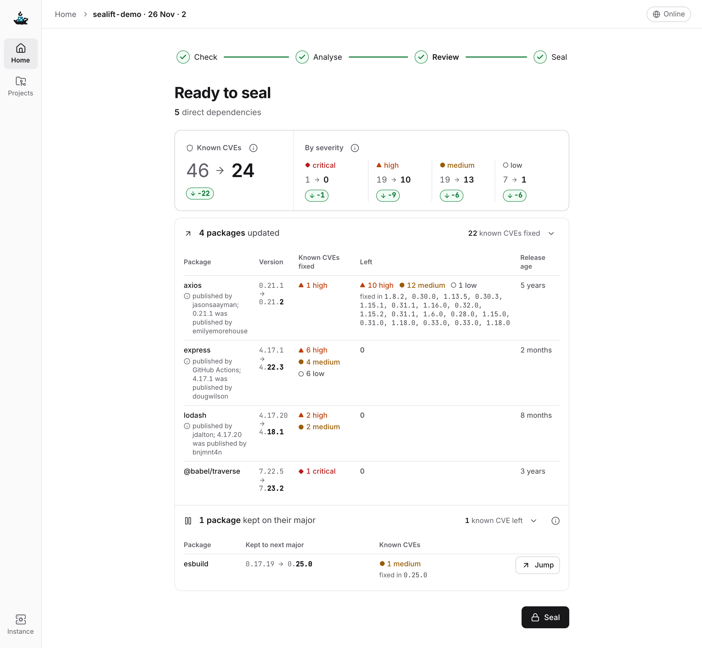

# How sealift chooses

This page explains how sealift picks the version it proposes for each dependency, what each signal on a candidate means, why the proposal can be older than the latest release, and when an export needs a reason in words.

## The short version

For each direct dependency, sealift proposes the version with the fewest CVEs, counted by severity, inside the dependency's current line. Among versions tied on CVEs, it takes the smallest jump from the current version, then the lowest version. A version that is too recent, does not run on your Node, does not resolve, or is deprecated is never proposed.

By default, sealift never proposes a version outside the line: it names one as the dependency's jump. Jumps that must move together form a family. An export that takes a jump, or keeps a CVE that no version fixes, needs a reason, and the signed manifest carries the reason to the import side.

## Which versions are candidates

The candidates for a dependency are its stable releases newer than the current one, as the npm registry lists them. Pre-releases such as `5.0.0-beta.1` are left out.

sealift resolves each candidate in isolation with pnpm: the dependency at that version, plus the project's own version of each peer dependency it declares. It then scans what the resolution pulls in with Trivy. A candidate's CVEs are those of the version itself and of everything it installs.

Some candidates are resolved first, and shown first in the review. They are the key versions:

- for each version Trivy names as fixing a CVE, the lowest candidate at or above it;
- the latest patch in the current minor;
- the latest release in the current major;
- the latest release overall.

**Show all 22 newer versions** in the review, with the count for that dependency, lists the others.

## Ranking by CVE count

sealift counts a candidate's distinct CVEs by severity: critical, high, medium, low, unknown. It compares two candidates one severity at a time, from the most serious:

| Candidate | Critical | High | Medium | Low | Rank |
| --- | --- | --- | --- | --- | --- |
| A | 0 | 3 | 0 | 0 | 2 |
| B | 0 | 2 | 9 | 9 | 1 |
| C | 1 | 0 | 0 | 0 | 3 |

B wins over A because it has fewer high CVEs, whatever its medium and low counts. C comes last because of its one critical.

When candidates tie, sealift takes the smallest jump: a patch in the same minor first, then a minor in the same major, then a new major. When they still tie, it takes the lowest version.

sealift proposes nothing when no candidate inside the line has fewer CVEs than the current version. The dependency then shows under Nothing to do.

## The current line

A dependency's line is the range npm's caret gives its current version, the versions `^4.17.1` would accept:

| Current | Line | Inside | Outside |
| --- | --- | --- | --- |
| 4.17.1 | major 4 | 4.17.3, 4.22.3 | 5.0.0 |
| 0.18.0 | 0.18 | 0.18.9 | 0.19.0 |
| 0.0.3 | 0.0.3 | no newer version | 0.0.4 |

From 1.0.0, the line is the major version. Below 1.0.0, semantic versioning promises nothing between minor versions, so the line is the minor version, and below 0.1.0 the patch version.

sealift proposes only inside the line, since a move inside it should not break the project. The policy key `review.proposeOtherMajors` widens the search to every candidate, as sealift 0.7.0 did. [Settings](settings.md#review-rules) lists the policy's review rules.

## The jump

A dependency with a newer line names its jump: the first candidate outside the line, in the order a proposal is taken. That is the fewest CVEs, then the smallest jump, then the lowest version. A blocked candidate is never a jump. A jump may carry more CVEs than the current version: it shows where the next line stands, and sealift never selects it for you.

## Families

Some jumps cannot happen alone. react-dom 19.2.0 declares the peer dependency `react ^19.2.0`, which excludes react 18.3.1 and admits react 19.2.0: react-dom cannot jump to 19 unless react does. sealift groups such dependencies into a family. Two dependencies with jumps join when one of these holds:

- the jump version of one declares a peer dependency on the other, with a range that excludes the other's current version and admits its jump;
- one is the other's `@types` package: `@types/react` for `react`, `@types/babel__core` for `@babel/core`.

A family holds two members or more. It is named after the member the others name most, with the line of its jump: `react 19`. A project on react, react-dom and `@types/react` 18, each with a jump to 19, gets one family, `react 19`, with all three.

Peer ranges decide, never names. react-router-dom 7 declares `react >=18`, which admits react 18.3.1, so react-router-dom 7 can jump alone and stays out of the `react 19` family. A family the peer dependencies do not declare goes unseen: each of its members then asks a reason of its own.

## Reasons

Two things in a selection need a reason before the export:

| What the selection carries | One reason per |
| --- | --- |
| A version outside its dependency's line | family, or lone dependency, it takes out of its line |
| A CVE that no version fixes, in a version the archive holds | dependency, for all such CVEs of the versions it holds |

A CVE counts as without fix when Trivy names no fixing version for it. An analysis made by sealift 0.7.0 recorded no fixing versions, so each of its CVEs counts as without fix. Run a new analysis to get them.

The versions an archive holds are the selected ones, plus the current ones when the export includes the project tree. A dependency the selection leaves out keeps its current version on the air-gapped side, so a CVE without fix in that version also needs a reason.

These ask no reason:

- a CVE whose only fix is in another line: it has a fix, even if the selection does not take it;
- a CVE with a fix that the selection leaves, by keeping the current version or by choosing another one;
- a move inside the line, the proposal included, unless the version it takes keeps a CVE without fix.

The signed manifest still lists each of these CVEs, with the versions that fix it.

A reason holds 1 to 300 characters once trimmed, on one line. Letters, marks, numbers, punctuation, symbols and the plain space pass; a tab, a line break, a control character, a line or paragraph separator, a bidirectional override or any other format character does not. The import side reads the reason by the same rule.

The deployment's policy can refuse instead. With `review.majorJump: refuse`, an export that takes a version outside its line is refused whatever reason it holds; `review.cveWithoutFix: refuse` does the same for a CVE without fix in a version the archive holds. A dependency the selection leaves out still asks a reason under `refuse`, since the archive does not carry it.

The server checks the reasons of every export, whatever the client. A refusal names each dependency, version and CVE that lacks a reason, one problem per line, and never repeats a reason's text:

```
express 4.17.1 to 5.1.0 leaves major 4 and needs a reason
html-minifier 4.0.0 keeps CVE-2022-37620, which no version fixes, and needs a reason
reason 2 (major-jump) covers nothing the selection takes
```

Under `refuse`, the problem names the policy key: `review.majorJump is refuse: react 18.3.1 to 19.2.0 cannot cross`.

[Workflow](workflow.md#reasons) shows where the review asks for them. [The air gap](air-gap.md#the-review-in-the-manifest) describes what the manifest carries.

## Why the oldest version that fixes the most

A release with no known CVE may have none because nobody has looked at it yet. An older release with the same count has had more time in use and more eyes on it. Taking the lowest version among equals also keeps the jump, and the risk of breaking the project, as small as it can be.

## Signals

A signal is a fact about a candidate worth a look. The review shows each one under the candidate, with its evidence.

The first four block a candidate: sealift never proposes it, and the review does not let you choose it.

| Signal | Meaning |
| --- | --- |
| `too-recent` | Published less than the minimum release age ago, 14 days by default, or with no publication date in the registry |
| `node-mismatch` | Its `engines.node` excludes the target's Node version |
| `does-not-resolve` | pnpm could not resolve it with the project's peer dependencies |
| `deprecated` | Its author deprecated it on the registry |

The other four inform:

| Signal | Meaning |
| --- | --- |
| `install-script-added` | It runs an install script; the current version does not |
| `provenance-lost` | The current version has a provenance attestation; this one has none |
| `publisher-changed` | A different npm account published it |
| `major-jump` | It leaves the current line: `leaves major version 4`, `leaves 0.18.x` |

## The minimum release age

A new release gets 14 days before sealift proposes it. The wait gives the package's users and the registry time to find a bad or compromised publish, and to pull or deprecate it. The same wait applies to the Trivy release sealift installs.

The wait also covers what a version pulls in: every resolution holds the packages under it to the same age. The exact versions your `package.json` pins and the version under test stay exempt, since sealift judges those itself. A project on a version younger than the wait can fail to resolve when that version pins equally young packages: the analysis names the package, and a shorter wait in the settings gets past it.

[Settings](settings.md#minimum-release-age) changes the wait, from 1 to 90 days.

## The three groups

The review sorts dependencies by sealift's proposal:

| Group | When |
| --- | --- |
| To decide | The proposal carries a signal other than `publisher-changed`, or, with `review.proposeOtherMajors`, is a major jump or a minor jump inside 0.x |
| Proposed | The proposal is a patch or minor jump with no such signal |
| Nothing to do | sealift proposes nothing |

Inside 0.x, semantic versioning makes no promise between minor versions, so `0.21.1` to `0.33.0` may break as much as a major jump. By default the proposal stays in its line, so neither kind of jump reaches To decide. `publisher-changed` alone does not move a row to To decide, since a new maintainer is common. The signal still shows on the candidate.

## A worked example

The demo project in [Getting started](getting-started.md) pins express 4.17.1, which carries 14 CVEs: 5 high, 3 medium, 6 low. Its line is major 4. The review shows its key versions:

| Version | CVEs | Signals | Outcome |
| --- | --- | --- | --- |
| 4.17.3 | 4 high, 3 medium, 6 low | | In the line, fewer CVEs |
| 4.19.2 | 4 high, 2 medium, 6 low | `publisher-changed` | In the line, fewer CVEs |
| 4.20.0 | 2 high, 3 medium, 4 low | `publisher-changed` | In the line, the fewest of these key versions |
| 4.22.3 | none | `too-recent`, `publisher-changed` | Blocked: released 9 days ago |
| 5.0.0 | 3 medium, 2 low | `publisher-changed`, `major-jump` | Outside the line, more CVEs than 5.1.0 |
| 5.1.0 | none | `publisher-changed`, `major-jump` | The jump |
| 5.2.1 | none | `publisher-changed`, `major-jump` | Outside the line, same count and jump as 5.1.0, higher version |

4.22.3 would fix every CVE without leaving major version 4, but it is 9 days old. sealift keeps express in major 4: it proposes the unblocked 4.x candidate with the fewest CVEs, which **Show all 22 newer versions** compares with the key versions above. 5.1.0 has no known CVE and 18 months in use, so it is express's jump. Choosing it asks a reason before the export. Once 4.22.3 is 14 days old, a new analysis proposes it.

sealift 0.7.0 proposed 5.1.0 here, a major jump, and the capture below shows that proposal. `review.proposeOtherMajors: true` brings it back.



## After the choice

Step 9 of the analysis resolves the whole project with every proposed version at once. A peer dependency the proposals leave unmet, and the project as given does not, also counts as a conflict, even though pnpm only warns about it. When they conflict, the analysis still finishes: the review shows the warning above the summary, and the log holds pnpm's output. Each proposal stays selectable. The export packs each selected version as the analysis resolved it, on its own, so it does not catch the conflict either: the install on the air-gapped side does. The members of a family are no exception: the export does not resolve their jumps together. When the log shows one, choose another version for one of the conflicting dependencies, or keep its current one.
