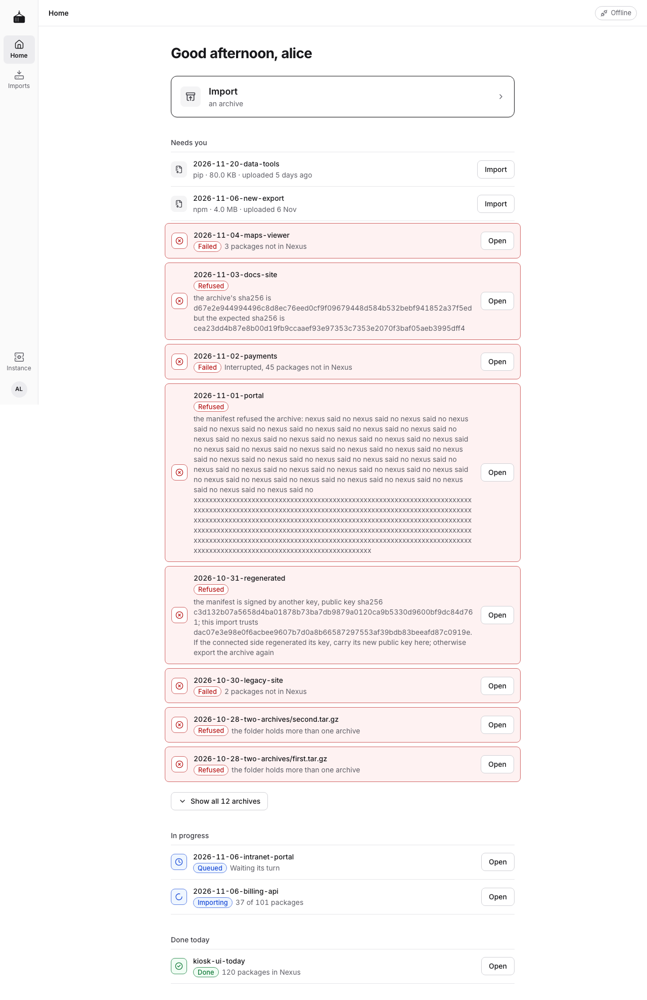

# Importing

This page covers the screens of `sealift import-server`, the import service on the air-gapped side: the home, Choose an archive, Imports, one import and Instance. The service publishes the packages of an archive to Nexus: npm packages from `packages/npm/`, Python wheels from `packages/pip/`. Each user sees their own archives and imports and no one else's.

Sign in through your organisation's gateway and open its address. Every screen sits in the same frame as the connected side's. The sidebar holds **Home** and **Imports**, then **Instance** and your initials at its foot. The top bar holds the breadcrumb and the side label, an unplugged plug with `Offline`. The import service reads no brand, so its screens show sealift's mark and the default labels.

## Home

The home greets you by name, such as `Good morning, alice`, and offers one card, **Import** an archive, which opens Choose an archive. Three groups follow, newest first. A group with no row is left out.

| Group | Holds | Row's action |
| --- | --- | --- |
| Needs you | Each archive in your folders with no import yet, with its ecosystem, its size and when it was uploaded, such as `uploaded 3 hours ago`; an archive that cannot be imported, or whose latest import was refused, marked Refused with its reason; and the latest import of an archive that ended incomplete or interrupted, marked Failed, with how many packages are not in Nexus | **Import** opens Choose an archive with that archive's start panel open; **Open** otherwise |
| In progress | Imports queued (Queued, Waiting its turn) or running (Importing, with the packages done so far) | **Open** |
| Done today | Imports that completed since midnight, with how many packages are in Nexus | **Open** |

A group shows ten rows, then **Show all**, such as Show all 12 archives and imports under Needs you. With nothing in any group, Needs you reads `No archive in` and your two folders, or that MinIO is not configured.

## The trusted key

**Instance**, at the foot of the sidebar, opens the import side's Instance page. It holds three sections:

| Section | Shows |
| --- | --- |
| Trusted key | Signing key, Ed25519, and `Public key sha256`: the first and last eight characters, which a press opens to the whole value, with a copy button. `An archive signed with any other key is refused.` Then **Compare** |
| Your folders | `Signed in as`, `Bucket`, `npm archives` and `pip archives` |
| Appearance | Theme, saved in this browser only |

The service reads the key from the file `publicKeyFile` names in its settings and checks every archive against it. Once, before the first crossing, check that it holds the key sealift signs with. Copy the Public key sha256 on sealift's Instance page, on the connected side, press **Compare** here and paste it into the field. The browser compares the two and sends nothing: the field reads `Matches the trusted key`, or `Does not match` with the position of the first character that differs, and a shorter value shows how many of the 64 characters you pasted. The pasted value may carry a `sha256:` prefix, colons, spaces or capitals. [The air gap](air-gap.md#the-signature-and-the-trusted-key) explains how the key gets here. When the two differ, this service does not trust that sealift: stop and carry the public key again.

## Choose an archive

Choose an archive lists the archives in your MinIO folders, newest first: `packages/npm/` and `packages/pip/` in your bucket, and one folder below each. An npm export goes under `packages/npm/` and a pip export under `packages/pip/`, each with the same three files. The line under the title counts them, such as `5 archives · 2 importable`. `All` and `Importable` filter the rows, and `Refresh` reads the folders again. The list also reads again each time you open the screen. The breadcrumb places it under Home.

An archive can be imported when its folder holds one archive, its `manifest.json` and its `manifest.json.sig`, side by side. Any other row says `Cannot be imported` and why:

| Reason on the row | What to do |
| --- | --- |
| `its name cannot be imported` | Rename or move it: the key must end in `.tar.gz`, sit in `packages/npm/` or `packages/pip/` or one folder below either, hold no empty, `.` or `..` segment and no control character, and stay within 1,024 bytes. |
| `the folder holds more than one archive` | Keep one archive with its manifest.json and manifest.json.sig in the folder. |
| `no manifest.json in its folder` | Upload the manifest next to the archive. |
| `no manifest.json.sig in its folder` | Upload the signature next to the manifest. sealift 0.4.0 and earlier wrote none: export such an archive again. |
| `its manifest is a pip archive's: keep the three files under packages/pip/` | Move the archive, its manifest and its signature to `packages/pip/`. |
| `its manifest is an npm archive's: keep the three files under packages/npm/` | Move the archive, its manifest and its signature to `packages/npm/`. |

The list reads each manifest to tell which folder it belongs in, at most 50 new manifests each time it reads the folders. A row past those 50, or whose manifest cannot be read, shows no such reason until a later list. The import itself checks the folder again once the signature verifies, and refuses an archive in the wrong one with `the manifest describes a pip archive, and this folder takes npm archives: move the three files to packages/pip/`, or `the manifest describes an npm archive, and this folder takes pip archives: move the three files to packages/npm/`.

When MinIO refuses to list one of the two folders, for instance before the administrator's MinIO policy covers `packages/pip/`, the list still shows the other folder's archives.

A pip archive needs a pip repository in the settings file. Without a `nexus.pip` section, its import is refused before the archive is read, with `the settings name no pip repository: set nexus.pip.repository`.

An importable row says `Can be imported`, then one of these:

- `Not imported yet` and the `Start` button.
- The state of the latest import of this archive, with its counts, and `Open import`. While that import is queued or running, the row says `Waiting its turn` or the packages done so far, and the link reads `Follow`.
- For a complete import whose archive is still listed, why it stayed: `Removal not recorded yet.`, or `Kept in MinIO:` and the reason.

Two notices can sit above the rows. One says the folder holds more than 1,000 objects and the list shows the first 1,000 in name order. The other says that the links to the key set, MinIO or Nexus run over plain http, so package contents and credentials cross the network unencrypted there.

An empty list says `No archive in your folder` and where to upload. `MinIO is not configured` means the administrator has not set the `minio` section of the settings file.

### Start an import

`Start` opens a panel under the row. It says what the import does and that imports run one at a time for every user, so yours may wait its turn. The field `Expected sha256 (optional)` takes the archive's sha256 as you received it through another channel. A value that is not 64 hexadecimal digits is refused on the spot. A different archive is refused after it is read, and nothing is published. `Start the import` begins, `Cancel` closes the panel, and Escape closes it too.

If the archive already has an import that has not completed, the panel says `This archive has an import that has not completed.` and sends you to follow or retry that one. If the archive left your folder meanwhile, it says `This archive is no longer in your folder.`

## Imports

Imports lists every import you started, newest first, with its state, its attempt and its counts of `published`, `present` and `failed` packages. A row that ended `incomplete` says how many packages are not in Nexus and sends you to its retry. `No import yet` is the empty list. While an import is running or queued, the list says `One import runs at a time; the others wait in the order they were started.` and updates every 5 seconds.

## One import

An import shows the archive's name and folder, its state, the settings it ran with (the attempt number, the start, the archive size, the Nexus repository and address, the target platform and the Node and pnpm versions), and a notice when Nexus, MinIO or the key set is reached over plain http.

### States

| State | Meaning |
| --- | --- |
| `Queued` | Waiting its turn. The panel says `Waiting its turn`. |
| `Running` | Going through its stages, see below. |
| `Complete` | Every package is in Nexus. |
| `Incomplete` | At least one package failed. |
| `Refused` | A check failed before the first package, the signature check first. |
| `Interrupted` | The service stopped before the attempt ended. |
| `Not recorded` | A record that names no state this version knows. |

While it runs, one panel shows the stage and stays in place: `Waiting its turn`, `Reading the manifest`, `Checking the archive` (the check reads the whole archive once and shows no byte progress, so a large archive can take minutes) and `Publishing packages: 37 of 101` with a bar and the counts `published`, `present`, `failed` and `pending`. The page updates every 2 seconds. When the attempt ends, the panel reads `Attempt 1 ended: Complete`, or the state that applies.

### How an attempt ends

| Card | When | What it says |
| --- | --- | --- |
| `Archive removed from MinIO` | `Complete`, the removal recorded | `All 101 packages are in Nexus: 0 published, 101 present.` The archive, the manifest and the signature were removed, in that order, after each still carried the ETag the import read. The card shows `Archive ETag`, `Manifest ETag` and `Signature ETag`. |
| `Archive removed from MinIO, manifest kept` | `Complete`, the manifest or the signature could not go | The reason follows. |
| `Archive kept in MinIO` | `Complete`, the removal failed or was refused | The reason, and a `Retry import` button. |
| `Checking the archive's removal` | `Complete`, no removal recorded yet | The page updates until the service records it. |
| `Refused before the first package` | `Refused` | The reason, such as both digests when the expected sha256 differs, or one of the signature reasons that [Troubleshooting](troubleshooting.md#import) lists. `This attempt published nothing and read no package.` and `Go to archives`. Starting the archive again is allowed. |
| `Stopped before it ended` | `Interrupted` | `The service stopped or restarted before this attempt ended.`, how many packages were finished and how many were not. |

The words `complete` and `removed` appear only when the record says so. The `Archive sha256 check` block says `The archive matched: its manifest carries a valid signature by this key, and the archive passed its checks against the manifest.` only when the attempt recorded that the signature verified and the checks passed, and `The archive has not passed its checks.` when it recorded that they did not. An attempt that has not reached the checks yet, because it is queued or running before the manifest is read, says `The archive's checks have not run yet.` An attempt that ended with no check result, such as one interrupted while it waited or a record written by 0.4.0, says `Not recorded: this attempt did not record the archive's checks.` A package of a 0.4.0 record has no kind, and its next action is the general one: `Read the reason: it names what failed. Fix that, then retry.`

The `Archive sha256 check` block shows `Expected sha256` (`No expected sha256 was given.` when you gave none), `Manifest sha256` and `Public key sha256`, the trusted key's, each with a `Copy` button. A record without the key's sha256 says `Not recorded`, and so does a record written by 0.4.0. Where the browser offers no clipboard, which is the case on a page served over plain http from any name other than `localhost`, the button selects the text and says `The clipboard is not available on this page. The text is selected: press Ctrl+C, or Command+C on a Mac, to copy it.`

### The retry card

An `Incomplete` import shows a card titled `1 of 101 packages are not in Nexus`. It lists what a retry does: it adds an attempt, reads the archive and its manifest from MinIO again and checks the sha256 again, reads every package from Nexus again, says how many are there already and stay untouched, uploads only what Nexus lacks and removes the archive only once every package is in Nexus. The card sorts the failures by what they need:

| Group | Kinds |
| --- | --- |
| `Can succeed on retry` | `interrupted`, `source`: retry as it is. |
| `Fails again until fixed outside sealift` | `conflict`, `mismatch`, `nexus`, `local`, each with its count and its words. |
| `Cause not recorded` | A package with no kind, or one this version does not know. |

For a `conflict`, the card says `Nexus holds this version with other bytes, and sealift never overwrites it. If that copy is the wrong one, delete it in Nexus, then retry.` The retry button is `Retry import`. A retry checks the signature again before anything else, so a retry of an import recorded by 0.4.0, which holds no signature, ends `Refused` as unsigned: start a new import from an archive exported again. If the service refuses it, the card says `The retry was refused` and why. Earlier attempts stay listed under `Earlier attempts`.

### Packages

`Packages` is a table with the columns `Package`, `State` and `Detail`. It lists each package of the attempt with its state, `Published`, `Present` (Nexus already held the same bytes), `Failed`, `Not finished`, `Pending` or `Not recorded`. A failed row is tinted and its detail gives the reason, then `Next:` and what to do. `All` and `Failed` filter the list. A long reason is cut: `Show full reason` opens it. An import that ends with failures opens on `Failed`.

## When your session ends

The gateway signs users out after a time. A screen that finds itself signed out says `Your session has ended` and `The page was signed out while you were away. Sign in again to carry on; nothing you started was changed.` with `Sign in again`. The notice replaces a list that was on screen, along with its count line and its `Refresh` button. Imports go on without the page.

An error page from the gateway is not a sign-out. While the service restarts, nginx answers with its own HTML page and status 502 or 504. A screen reads that as a failed request: a list on screen stays, with `The last refresh failed. The list is as it was.` next to its count. A screen with nothing to show says `This could not be loaded` with `Try again`, and Choose an archive says `The archives could not be listed` on a 502.

A gateway page with a 4xx status, such as a 403, 404 or 429, is a failed request too, and its words say that the gateway refused the request with that status. Only a 401, a redirect to the sign-in page or a 2xx answer that is not the service's JSON reads as a sign-out.

## Checked in the lab

An earlier run read the import screens on the lab's gateway at http://localhost:18440 (see `lab/README.md`), signed in as `alice` and `bob`, in a browser driven by script. Its image predates the frame, the home and the Instance page, and showed the archive list as its own screen, Archives. The captures of one import come from that run. The browser gate covers the newer screens, and the home's capture comes from its fixtures. The run covered:

- Archives with five rows: two in a folder holding two archives, one in a folder with no manifest, one not imported yet and one whose import ended incomplete. Archives while one import ran and another waited, with the `Follow` links.
- Imports, with imports of every state the lab held, and each of these on its own page: a complete import with the archive removed, an incomplete one with a planted conflict, a refused one, a running one at 37 of 101 packages, a queued one and an interrupted one after `docker compose restart import-server`. The queued import read `The archive's checks have not run yet.` and, once the restart had interrupted it before it started, `Not recorded: this attempt did not record the archive's checks.`
- The session ending: deleting the `_oauth2_proxy` cookie and pressing `Refresh` on Archives, and opening Imports from an import page, each replaced the list with `Your session has ended`.
- A stopped `import-server`: the gateway answered `/api/imports` with a 502 `text/html` page, and the running import's page kept its panel and never said `Your session has ended` over 26 seconds. A 502 HTML answer to the Archives `Refresh`, served by the script, left the 10 rows in place with `The last refresh failed. The list is as it was.`
- `bob` saw none of alice's archives or imports, and her import's address answered `No such import` to him.

Not driven in the lab this time: the cards for a kept archive and a removal not yet recorded, a retry, an import that was refused after an incomplete attempt, and the clipboard fallback of `Copy`. The unit tests and the browser gate's fixtures cover the cards and the wording.

The signature was checked in the lab on commit 744e44c, through the command and the service's API, not through these screens in a browser: the trusted key's sha256 from `GET /api/me` equalled the one sealift's `GET /api/signing-key` gave, an export of the connected sealift imported `complete` through `sealift import` and through the service, a manifest changed by one byte was refused with `the signature does not match the manifest` (exit 3), an export made after a regenerate was refused with `the manifest is signed by another key` and both sha256 named, a folder without `manifest.json.sig` listed its archive as not importable, and an archive from the 0.4.0 image was refused as unsigned.
