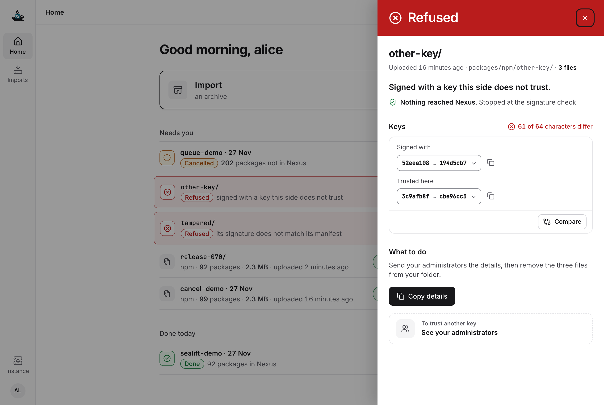
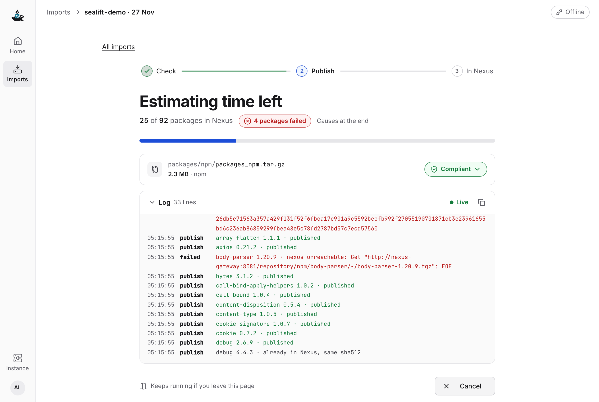
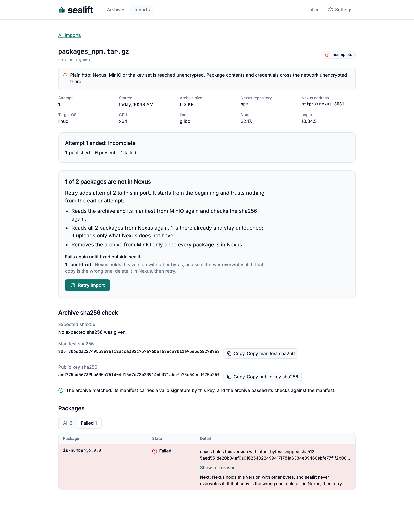
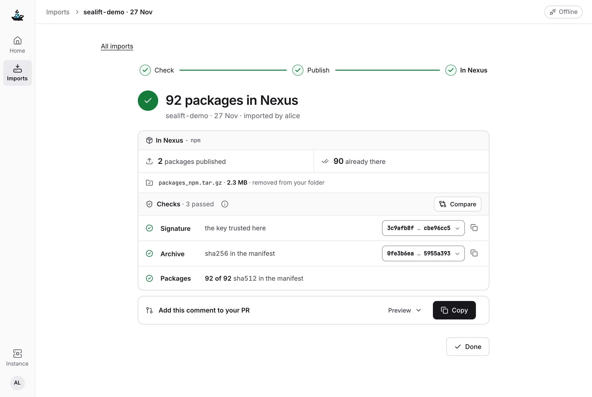

# Importing

This page covers the screens of `sealift import-server`, the import service on the air-gapped side: the home, Choose an archive, Imports, one import and Instance. The service publishes the packages of an archive to Nexus: npm packages from `packages/npm/`, Python wheels from `packages/pip/`. Each user sees their own archives and imports and no one else's.

Sign in through your organisation's gateway and open its address. Every screen sits in the same frame as the connected side's. The sidebar holds **Home** and **Imports**, then **Instance** and your initials at its foot. The top bar holds the breadcrumb and the side label, an unplugged plug with `Offline`. The import service reads no brand, so its screens show sealift's mark and the default labels.

## Home

The home greets you by name, such as `Good morning, alice`, and offers one card, **Import** an archive, which opens Choose an archive. Three groups follow, newest first. A group with no row is left out.

| Group | Holds | Row's action |
| --- | --- | --- |
| Needs you | Each archive in your folders with no import yet; an archive the list refused, marked Refused with its reason; and the latest import of an archive that ended incomplete, interrupted or cancelled, marked Failed or Cancelled, with how many packages are not in Nexus | **Import** opens Choose an archive with that archive's start panel open; **Open** otherwise |
| In progress | Imports queued (Queued, Waiting its turn) or running (Importing, with the packages done so far) | **Open** |
| Done today | Imports that completed since midnight, with how many packages are in Nexus | **Open** |

A group shows ten rows, then **Show all**, such as Show all 12 archives. With nothing in any group, Needs you reads `No archive in` and your two folders, or that MinIO is not configured.

### An archive's row

The service checks each archive's signature when it lists your folder, before anyone presses Import. An archive whose signature verifies with the trusted key is named by the crossing its signed manifest records: the project and the day it was sealed, such as `sealift-demo · 27 Nov`, and `· 2` after the second crossing of the same project that day. A manifest from sealift 0.7.0 or earlier names no project, so its row shows the folder, such as `release-070/`. Under the name, the row reads `npm · 92 packages · 2.3 MB · uploaded less than a minute ago`.

A verified archive carries the **Compliant** chip. Pressing it opens `3 checks passed`:

| Check | What it says |
| --- | --- |
| Files | The folder `holds the archive, its manifest and its signature` |
| Signature | `Ed25519, by the key this side trusts` |
| Folder | `an npm manifest, in packages/npm/`, or the pip one |
| Contents | `sha256 and sha512, checked when the import starts`, shown as not yet checked |

An archive the list has not checked yet reads `Not checked yet` in place of the chip. The list checks at most 50 new manifests each time it reads the folders, and the next list checks the rest.

### A refused archive

An archive whose files fail a check sits under Needs you, marked Refused with its reason, such as `signed with a key this side does not trust` or `its signature does not match its manifest`. **Open** shows the refused panel over the home.

The panel's title names the cause: `The signature does not match the manifest.`, `Signed with a key this side does not trust.` or `The archive does not match its manifest.`. Under it, `Nothing reached Nexus. Stopped at the signature check.` The Files block lists the archive, `manifest.json` and `manifest.json.sig` with their state, such as `Not checked` or `Do not match`. For an unknown key, a Keys block sets `Signed with` beside `Trusted here`, both as sha256, and counts how many characters differ. **Copy details** puts the facts on the clipboard for your administrators.

`What to do` says how to clear it:

| Cause | What to do |
| --- | --- |
| A file changed after the export | `Download the files marked Do not match again from Online.` A new upload into the same folder replaces them, and the next list checks them again. `If the new copy is refused too`, see your administrators. |
| Another key signed it | `Send your administrators the details, then remove the three files from your folder.` `To trust another key` follows. |

The panel has no button to remove the files. Remove them in MinIO's browser.

## The trusted key

**Instance**, at the foot of the sidebar, opens the import side's Instance page. It holds three sections:

| Section | Shows |
| --- | --- |
| Trusted key | Signing key, Ed25519, and `Public key sha256`: the first and last eight characters, which a press opens to the whole value, with a copy button. `An archive signed with any other key is refused.` Then **Compare** |
| Your folders | `Signed in as`, `Bucket`, `npm archives` and `pip archives` |
| Appearance | Theme, saved in this browser only |

The service reads the key from the file `publicKeyFile` names in its settings and checks every archive against it. Once, before the first crossing, check that it holds the key sealift signs with. Copy the Public key sha256 on sealift's Instance page, on the connected side, press **Compare** here and paste it into the field. The browser compares the two and sends nothing: the field reads `Matches the trusted key`, or `Does not match` with the position of the first character that differs, and a shorter value shows how many of the 64 characters you pasted. The pasted value may carry a `sha256:` prefix, colons, spaces or capitals. [The air gap](air-gap.md#the-signature-and-the-trusted-key) explains how the key gets here. When the two differ, this service does not trust that sealift: stop and carry the public key again.

## Choose an archive

Choose an archive lists the archives in your MinIO folders, newest first: `packages/npm/` and `packages/pip/` in your bucket, and one folder below each. An npm export goes under `packages/npm/` and a pip export under `packages/pip/`, each with the same three files. The line under the title counts them, such as `5 archives · 2 importable`. `All` and `Importable` filter the rows, and `Refresh` reads the folders again. The list also reads again each time you open the screen. The breadcrumb places it under Home.

An archive can be imported when its folder holds one archive, its `manifest.json` and its `manifest.json.sig`, side by side. Any other row says `Cannot be imported` and why:

| Reason on the row | What to do |
| --- | --- |
| `its name cannot be imported` | Rename or move it: the key must end in `.tar.gz`, sit in `packages/npm/` or `packages/pip/` or one folder below either, hold no empty, `.` or `..` segment and no control character, and stay within 1,024 bytes. |
| `the folder holds more than one archive` | Keep one archive with its manifest.json and manifest.json.sig in the folder. |
| `no manifest.json in its folder` | Upload the manifest next to the archive. |
| `no manifest.json.sig in its folder` | Upload the signature next to the manifest. sealift 0.4.0 and earlier wrote none: export such an archive again. |
| `its manifest is a pip archive's: keep the three files under packages/pip/` | Move the archive, its manifest and its signature to `packages/pip/`. |
| `its manifest is an npm archive's: keep the three files under packages/npm/` | Move the archive, its manifest and its signature to `packages/npm/`. |
| `signed with a key this side does not trust` | Send your administrators the details from the refused panel, then remove the three files. |
| `its signature does not match its manifest` | Download `manifest.json` and `manifest.json.sig` again from the connected side and upload them into the same folder. |
| `the archive does not match its manifest` | The archive's size differs from the one the signed manifest states: download the archive again. |
| `its manifest cannot be read` or `its manifest.json.sig cannot be read` | Upload the file again: it was cut or replaced in transit. |

The list checks each manifest's signature with the trusted key, then reads which folder the manifest belongs in. It checks at most 50 manifests it has not checked before, and reads at most 64 MiB, each time it reads the folders. A row past those bounds reads `Not checked yet` until a later list. A new upload of the manifest or its signature is checked again. The import itself checks everything again when it starts, and refuses an archive in the wrong folder with `the manifest describes a pip archive, and this folder takes npm archives: move the three files to packages/pip/`, or `the manifest describes an npm archive, and this folder takes pip archives: move the three files to packages/npm/`.

When MinIO refuses to list one of the two folders, for instance before the administrator's MinIO policy covers `packages/pip/`, the list still shows the other folder's archives.

A pip archive needs a pip repository in the settings file. Without a `nexus.pip` section, its import is refused before the archive is read, with `the settings name no pip repository: set nexus.pip.repository`.

An importable row says `Can be imported`, then one of these:

- `Not imported yet` and the `Start` button.
- The state of the latest import of this archive, with its counts, and `Open import`. While that import is queued or running, the row says `Waiting its turn` or the packages done so far, and the link reads `Follow`.
- For a complete import whose archive is still listed, why it stayed: `Removal not recorded yet.`, or `Kept in MinIO:` and the reason.

Two notices can sit above the rows. One says the folder holds more than 1,000 objects and the list shows the first 1,000 in name order. The other says that the links to the key set, MinIO or Nexus run over plain http, so package contents and credentials cross the network unencrypted there.

An empty list says `No archive in your folder` and where to upload. `MinIO is not configured` means the administrator has not set the `minio` section of the settings file.

### Start an import

`Start` opens a panel under the row. It says what the import does and that imports run one at a time for every user, so yours may wait its turn. The field `Expected sha256 (optional)` takes the archive's sha256 as you received it through another channel. A value that is not 64 hexadecimal digits is refused on the spot. A different archive is refused after it is read, and nothing is published. `Start the import` begins, `Cancel` closes the panel, and Escape closes it too.

If the archive already has an import that has not completed, the panel says `This archive has an import that has not completed.` and sends you to follow or retry that one. If the archive left your folder meanwhile, it says `This archive is no longer in your folder.`

## Imports

Imports lists every import you started, newest first, with its state, its attempt and its counts of `published`, `present` and `failed` packages. `No import yet` is the empty list. While an import is running or queued, the list says `One import runs at a time; the others wait in the order they were started.` and updates every 5 seconds.

## One import

An import's page names it as the home does, such as `sealift-demo · 27 Nov`, and sets a step bar above it: `Check`, `Publish` and `In Nexus`. The settings it ran with follow: the archive size, the Nexus repository and address, and the target. A notice says when Nexus, MinIO or the key set is reached over plain http.

### In the queue

Imports run one at a time for every user. A queued import reads `Waiting its turn`, then its place, such as `1 import ahead of this one` or `No import ahead of this one`, and `Keeps its place if you leave this page`. **Cancel** takes it out of the queue at once, with no confirm: nothing has run yet.

### Check and publish

Once its turn comes, the import reads the manifest, then checks the archive against it. The check reads the whole archive once, so a large archive can take minutes. When the checks pass, the archive's line gains the **Compliant** chip, and its `3 checks passed` reads Signature `Ed25519, by the key this side trusts`, Archive `sha256 as the signed manifest states it` and Packages, such as `92 sha512 as the manifest lists them`.

While it publishes, the title reads the time left, `Estimating time left` at first, and the line under it counts, such as `54 of 92 packages in Nexus` and `3 packages failed`, with `Causes at the end`. The log below grows as each package ends. A reload brings it back with no line twice. Nexus's own answers, such as its 413 page, show in the log and nowhere else, as text.

**Cancel** asks first, in place: `Packages already in Nexus stay there; a retry publishes the rest.`, with **Keep running**, which holds the focus, and **Cancel import**. The package in flight finishes, and the packages not reached fail as stopped before they were published. The page then reads `Import cancelled`, how long it ran and how many packages are in Nexus, such as `After 1 min 12 s. 63 of 265 packages are in Nexus.`, the log, and **Retry 202 packages**. A cancelled import removes nothing from MinIO, and its archive cannot start a second import until this one completes.

### The causes of a failed import

An import that ends with failures reads, for example, `5 packages not in Nexus`, then `87 of 92 packages in Nexus. The archive stays in MinIO until all are in.` One closed block follows per cause, each with its packages and the action that clears it. The first cause a retry can clear leads with the page's primary **Retry**. The log stays folded below, and `Still blocked after these steps?` names your administrators last.

| Cause | What the block says and offers |
| --- | --- |
| `No answer from Nexus` | `Nothing needs to change before a retry.` and Retry, such as **Retry 2 packages**. |
| `Too large for Nexus` | `Nexus refused this file as too large.`, the file's size and, when a smaller file went through in any attempt, `The largest file that went through is 308.2 KB, so the limit sits between the two sizes.` Then `Raise Nexus's upload limit above this file's size` with **Copy request** for Nexus's administrators, and Retry once the limit is raised. |
| `Nexus refused it` | Nexus's status, such as `Nexus answered 401 and 500 to these 2 packages. Its words are in the log.`, and Retry. A status this version does not name reads the same way, with its number. |
| `Another file under the same version` | `Nexus holds` the version `with a different sha512`. The steps are `Compare the two sha512`, `Remove the copy in Nexus` with **Copy its path**, then Retry once the copy is removed. Under Nexus's copy, `Uploaded` gives the day and, when Nexus says so, the account. sealift never overwrites a version. |
| `Could not read the archive from MinIO` | `MinIO did not give the archive's bytes for` the packages, `A retry reads the archive again.`, and Retry. |
| `Stopped before it was published` | `Nothing needs to change before a retry.` and Retry. |
| `Not the package the manifest names` | The archive does not hold what its manifest names, `so a retry would read the same files.` Bring the archive again from Online, then start a new import. |
| `Failed on this side` | `Something on this side failed` with a file of the service or its Nexus client. Retry, and ask the contact if it fails the same way. |
| `Not in Nexus` | A package recorded by sealift 0.4.0 or earlier, which kept no cause: `Recorded by an older sealift, with no cause.` and its reasons, then Retry. |

Each Retry sends only that cause's packages. Every other package is read from Nexus and never uploaded, and one Nexus still lacks keeps the cause it had. [Troubleshooting](troubleshooting.md#a-failed-import) gives each cause's fix. Earlier attempts stay listed under `Earlier attempts`, each with its report.

### Done

A completed import reads, for example, `92 packages in Nexus` and `sealift-demo · 27 Nov · imported by alice`. Under `In Nexus · npm` it counts `2 packages published` and `90 already there`, across every attempt of the import, and names the archive `removed from your folder`, or `Checking whether it left your folder` until the removal is recorded.

`Checks · 3 passed` lists Signature, Archive and Packages, such as `92 of 92 sha512 in the manifest`, each sha256 by its first and last eight characters. `Compare with the connected side` takes a sha256 you paste, such as the one `shasum -a 256` gives for the sealed file, and says `Matches the archive's sha256`, `Matches the signing key's sha256` or how many characters differ. The browser compares and sends nothing.

`Add this comment to your PR` holds a table to paste into the pull request that asked for the packages: Packages in Nexus, Packages updated, Known CVEs before and after, Carried with a reason, Major jumps and the archive's sha256 in full. The update, CVE, reason and jump figures come from the review the signed manifest carries. **Preview** opens the comment in place, and **Copy** puts it on the clipboard. Where the browser offers no clipboard, the comment is selected for Ctrl+C. **Done** goes back to the home.

The comment carries no link to the import and the page has no report link yet: the import's page answers only its importer, so a reviewer could not open it.

### Other ends

| End | What the page says |
| --- | --- |
| `Refused` | `Refused before the first package`, the reason, and `This attempt published nothing and read no package.` Starting the archive again is allowed. |
| `Interrupted` | `The service stopped or restarted before this attempt ended.` with how many packages were finished. |
| A complete import whose archive stayed | `Kept in your folder` and the reason. |

A record written by sealift 0.4.0 shows `Not recorded` for every field it lacks, such as the start or the Nexus repository.

## When your session ends

The gateway signs users out after a time. A screen that finds itself signed out says `Your session has ended` and `The page was signed out while you were away. Sign in again to carry on; nothing you started was changed.` with `Sign in again`. The notice replaces a list that was on screen, along with its count line and its `Refresh` button. Imports go on without the page.

An error page from the gateway is not a sign-out. While the service restarts, nginx answers with its own HTML page and status 502 or 504. A screen reads that as a failed request: a list on screen stays, with `The last refresh failed. The list is as it was.` next to its count. A screen with nothing to show says `This could not be loaded` with `Try again`, and Choose an archive says `The archives could not be listed` on a 502.

A gateway page with a 4xx status, such as a 403, 404 or 429, is a failed request too, and its words say that the gateway refused the request with that status. Only a 401, a redirect to the sign-in page or a 2xx answer that is not the service's JSON reads as a sign-out.

## Checked in the lab

A run on commit 109ff80 drove these screens on the lab's gateway at http://localhost:18440 (see `lab/README.md`), signed in as `alice` and `bob`, in a browser driven by script. The captures on this page come from it. It showed:

- The home with two Compliant archives, the chip's four checks, and two Refused folders: one whose manifest was edited after signing, one signed by another key. Each panel named its cause and its fix.
- bob's import ahead of alice's: her page read `1 import ahead of this one` until his ended.
- Three causes planted in one attempt: `No answer from Nexus` for two packages, `Too large for Nexus` for a 467.8 KB file under a 400 KB limit, and `Another file under the same version` for two versions planted with other bytes. Each cause's Retry then cleared it alone, and the last one ended Done.
- The done page's comment matched the signed manifest's review figure for figure, and `Compare with the connected side` matched the sha256 that `shasum -a 256` gave on the connected side.
- A cancel during a 265-package import: Keep running kept it going, and Cancel import ended it `cancelled` with 63 packages in Nexus and none removed.
- A copy of a lab volume written by 0.4.0 to 0.7.0, with 24 records, and an archive exported by 0.7.0: every record opened with no error, and the 0.7.0 archive was listed by its folder.

The same run found that Nexus 3.96.5 stores a scoped package such as `@babel/code-frame` under the group `babel` and the name `code-frame`. The service now asks Nexus for a scoped package's upload facts by that group and name. It also found that Nexus withholds the uploader from the lab's import account: a conflict's copy read `Uploaded 27 Nov 2026` with no account, and the same search as admin named one. An import account with the least privileges never shows who uploaded the other copy.

Not driven in this run: the clipboard of Copy details and of the comment in a real browser, and the screens after the fixes that followed the run. The unit tests and the browser gate cover them.
