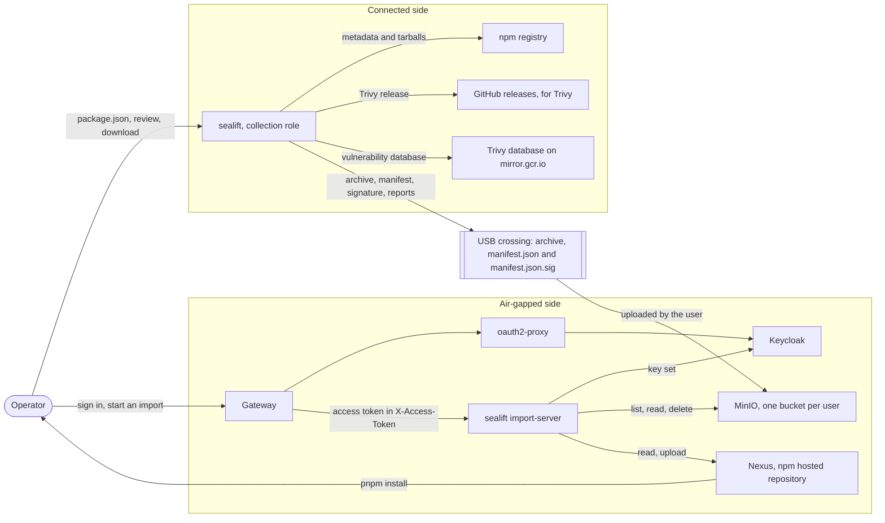
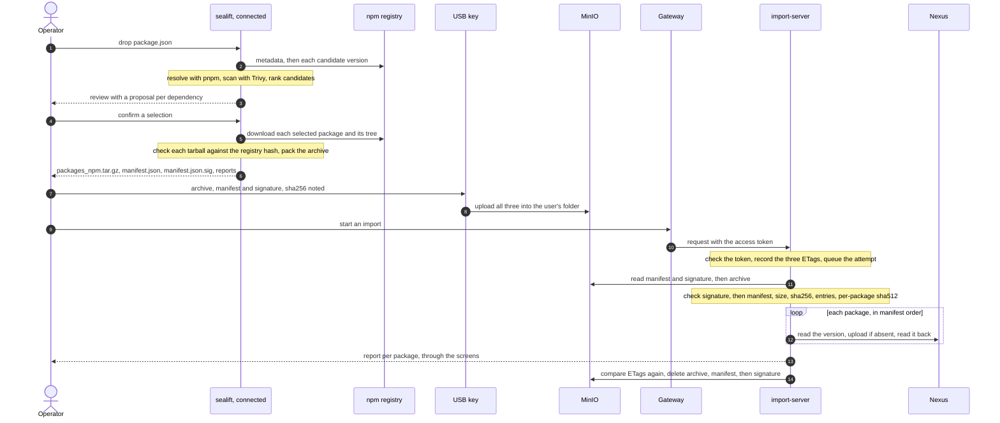
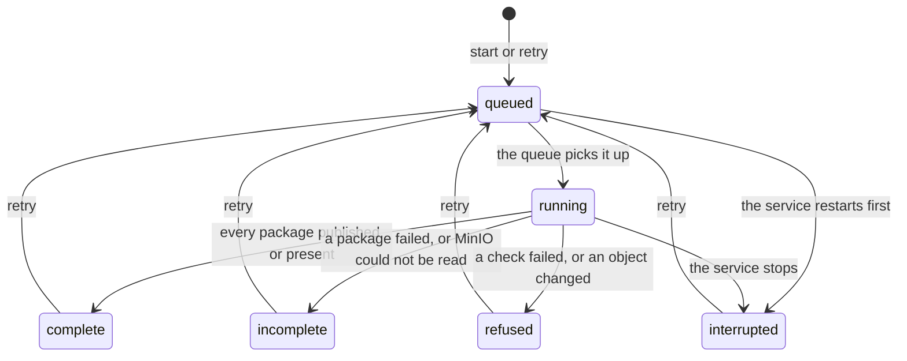

# Overview

This page describes the whole of sealift in one read: what it is for, the two sides it connects, how an archive crosses the air gap, what each check proves, and where each piece of state lives. It is the page to read first, whether you operate sealift or change its code. Every other page goes deeper on one part, and the last section lists them.

## What sealift is for

An air-gapped network installs npm packages from an internal registry, and someone has to fill that registry with versions that are safe to install. sealift rebuilds that chain in two roles of one Go binary:

- The collection role runs on a connected machine. It reads a `package.json`, finds the known CVEs in the packages it pulls in, ranks the newer version of each direct dependency, lets a person review the proposal, and packs the chosen versions into an archive with a signed manifest and reports.
- The import role runs on the air-gapped network. It checks the manifest's signature and the archive against the manifest, and publishes its packages to a Nexus repository. It runs as `sealift import`, a command for one archive, or as `sealift import-server`, a service behind a gateway that signs users in. Each user imports from their own MinIO folder.

The image `ghcr.io/morgankryze/sealift` carries both roles. The two sides share the archive format and no network: a person carries the files from one to the other. The collection side handles npm only, and takes a `package.json` whose direct dependencies are pinned to exact versions ([FAQ](faq.md)).

## The two sides



The gateway, oauth2-proxy and Keycloak belong to the air-gapped network and sit outside sealift. sealift expects a gateway that checks the user and forwards the access token in one header, and it checks that token itself. [Deployment](deployment.md#the-import-service) describes what the gateway must do, and [`lab/README.md`](../lab/README.md) runs the whole picture on one machine.

## One crossing, end to end



The operator checks the archive's sha256 on both sides of the USB key and can pass the value to the import as `expectedSha256`. [The air gap](air-gap.md) covers that routine.

## The collection pipeline

A session holds one `package.json`. Its screens follow four steps: Drop, Analyse, Review, Export ([Workflow](workflow.md)). The server runs one job at a time, in memory and in submission order, and streams the job's events to the interface ([Architecture](dev/architecture.md#requests-and-jobs)).

| Stage | What happens | Detail |
| --- | --- | --- |
| Validate | `npm.Manifest.Validate` refuses ranges, tags, non-registry sources and the fields `overrides` and `resolutions` | [Workflow](workflow.md#drop) |
| Resolve | pnpm resolves the project for the target platform with `pnpm install --lockfile-only` | [Architecture](dev/architecture.md#the-analysis) |
| Scan | Trivy scans the resolved project and reports its CVEs | [Architecture](dev/architecture.md#the-analysis) |
| Candidates | The registry lists the newer stable versions of each direct dependency. sealift resolves each one in isolation and scans it, key versions first | [Ranking](dev/ranking.md#key-versions) |
| Ranking | Each candidate gets a CVE vector and signals. The proposal is the version with the fewest CVEs, then the smallest jump, then the lowest version. A last step resolves every proposal together and records a conflict as a warning | [How sealift chooses](how-sealift-chooses.md), [Ranking](dev/ranking.md) |
| Review | A person accepts the proposal or picks another candidate per dependency. Candidates with a blocking signal, such as `too-recent`, cannot be picked | [Workflow](workflow.md#review) |
| Export | sealift downloads the selected packages and their trees, checks each tarball against the registry's sha512, packs `packages_npm.tar.gz` and writes the manifest and four reports | [Architecture](dev/architecture.md#the-export), [Archive format](dev/archive-format.md) |

The analysis is nine steps and the export five, each with an id that the events and `status.json` carry. A failing step stops the job and shows its message. The minimum release age, 14 days by default, holds back young releases and the packages they pull in ([Settings](settings.md#minimum-release-age)).

## The import pipeline

`sealift import` runs the checks and the publishing for one archive on local files and prints a report. `sealift import-server` wraps the same run in a queue, a record per import and a MinIO source. The steps of one attempt in the service are:

1. Start. `POST /api/imports` checks the token, takes the user from its `preferred_username` claim, checks that the key names an importable archive in the user's folder and lists the folder. An archive is importable only with its `manifest.json` and `manifest.json.sig` beside it. It records the ETags and sizes of the archive, its manifest and its signature. It answers 409 when the same objects already have an import that is queued, running, incomplete or interrupted.
2. Queue. Imports run one at a time across all users, in the order they started. The queue marks the attempt running and makes a working directory for it.
3. Compare ETags. The attempt heads the three objects and compares them with the recorded ETags. A changed object ends the attempt refused, and a missing one ends it incomplete.
4. Check the signature. The service reads `manifest.json` and `manifest.json.sig` from MinIO and checks the signature against the trusted public key. Only then does it parse and validate the manifest, so no unauthenticated JSON is parsed. Every package is then listed as pending.
5. Check the archive. The service reads the archive once from MinIO and checks it against the manifest ([Archive format](dev/archive-format.md#what-sealift-import-checks)). A failed check ends the attempt refused and publishes nothing.
6. Publish. For each package, in manifest order, the run inspects the tarball and reads the version from Nexus. A version with the same bytes is `present`. A version with other bytes is a `conflict` and is never overwritten. A missing version is uploaded and read back, and it is `published` only when the read-back digest matches. The state of each package is stored as soon as it ends.
7. End. The attempt's outcome and report are stored. The outcome is `complete` when every package is published or present, and `incomplete` when one failed.
8. Remove. After a `complete` end, the service heads the three objects again, and deletes the archive, then its manifest, then its signature, only if each still carries the recorded ETag. The result is stored as the attempt's removal.
9. Retry. `POST /api/imports/{importId}/retry` adds an attempt. It repeats every step above, reads every package from Nexus again and uploads only what Nexus lacks.



The diagram shows the states of one attempt. An import has one or more attempts, and its state is the state of the latest one. At start, the service marks every attempt a restart cut short as `interrupted` and starts nothing on its own ([Importing](importing.md#states) lists the words the screens use).

Each failed package carries a kind: `conflict`, `nexus`, `source`, `interrupted`, `mismatch` or `local`. The kind tells a reader whether a retry can clear the failure or something outside sealift must change first ([The import report](dev/archive-format.md#the-import-report)).

## Trust and integrity

Each check answers a different question about what arrived.

| Check | Where | What it proves | What it leaves open |
| --- | --- | --- | --- |
| Registry sha512 on download | Export | Each tarball is the one the registry published, per the lockfile. A tarball that does not match stops the export | A malicious package with no published CVE is not detected |
| Archive sha256 | Manifest field `archive.sha256`, checked by the import | The archive is the file the export wrote. The operator can also compare it with a value received by another channel and pass it as `expectedSha256` | The manifest travels next to the archive, so only a value from a separate channel shows the manifest itself is the exporter's |
| Per-package sha512 | Manifest field `shippedSha512`, checked by the import | Each tarball in `out/` is the file listed for it. `originalIntegrity` also matches unless sealift removed `publishConfig` from that package | The hash covers the file's bytes and says nothing about what the package does |
| The manifest | `archive.ParseManifest` | The manifest has the known shape: bounded size, valid names, versions and file names, printable text, no duplicate. The archive holds exactly the files it lists | A manifest from a newer `formatVersion` is refused |
| Signature | `manifest.json.sig`, checked by the import against the trusted public key | The manifest was made by the holder of the private key and has not changed since. The manifest names the archive's sha256 and the sha512 of every package, so one signature covers every byte the import publishes | It does not show who pressed Export, it has no freshness check, and the four reports are not signed. A key carried with the archive would prove nothing, so the import trusts only the public key file its settings name |
| Token check | `internal/importer/token` | A request carries an access token signed by the realm's keys, for the expected issuer and audience, and within its lifetime with 60 seconds of leeway. Only asymmetric algorithms pass | The token is checked when a request arrives. An import that started goes on after the token expires |
| Per-user scope | `internal/importer/service` | A user sees their own bucket, archives and imports. The service reads the user from the token's claim and from nowhere else, and another user's import answers 404 | The gateway must set `X-Access-Token` from its own variable |
| Nexus read-back | `internal/importer` | An uploaded package is served with the shipped bytes. An existing version with other bytes is never overwritten | Set the repository's deployment policy to disable redeploy, so Nexus refuses an overwrite as well |

The import side trusts one Ed25519 public key. Compare its sha256 fingerprint on both sides when you carry the key ([The air gap](air-gap.md#the-signature-and-the-trusted-key)).

Least privilege shows up on each side:

- The collection server runs as `app`. pnpm and Trivy run as `tools`, which cannot read `private/settings.json`.
- The import roles run from a copy of the binary with no capability, as user 10000, under `--cap-drop ALL`.
- The MinIO service user can list, read and delete under `packages/npm/` in the `user-*` buckets and nothing else. The service client never writes an object.
- The Nexus user of the import holds browse, read, add and edit on one repository and the upload privilege ([The air gap](air-gap.md#the-import)).
- A `POST` to the import API is refused when it looks cross-site, and the service sends a Content-Security-Policy and framing headers on every answer.

The collection side has no login. Keep it on a loopback address or behind a proxy that authenticates ([Deployment](deployment.md#access)).

## What lives on disk

The collection role keeps everything under `/data`:

```
/data
  private/        settings.json and signing-key.pem: the settings and the private signing key, readable by app only
  projects/       one folder per session
    <session>/
      analyses/   one folder per analysis: status, log, lockfiles, scans, ranking
      exports/    one folder per export: the archive and its reports
  tools/          Trivy versions, the active one, and pnpm
  trivy-cache/    the vulnerability database
  cache/          pnpm, resolution and tarball caches
  home/           the home directory of pnpm and Trivy
```

The import-server keeps its records under `<data>/imports`, with `/data` as the default data directory:

```
/data/imports
  <user>/
    <import id>/
      import.json   the import, its attempts, each report and each removal
      work-<n>/     the working files of a running attempt, removed when it ends
```

The server also reads the settings file and the secret files beside it from a read-only folder, `/import` in the lab. That folder holds the Nexus, token and MinIO settings, the Nexus password, the MinIO key pair and the trusted public key file. The archives stay in MinIO until an import completes and removes them. The volume must outlive the container, since a restart reads the records.

[Architecture](dev/architecture.md#the-data-volume) and [Deployment](deployment.md#the-data-volume) describe the collection layout in more detail.

## Deployment shapes

The connected side runs as one container with one volume, bound to a loopback address or put behind a proxy that authenticates. The air-gapped side runs `sealift import-server` in a read-only container with no capability, behind a gateway and oauth2-proxy that sign users in, next to Keycloak, MinIO and Nexus. [Deployment](deployment.md) covers both, and [`lab/README.md`](../lab/README.md) starts a local copy of both sides with the crossing protocol.

## Glossary

| Term | Meaning |
| --- | --- |
| Archive | `packages_npm.tar.gz`: one folder, `out/`, with one npm tarball per package |
| Manifest | `manifest.json`: every package with its hashes, the target and the archive's own sha256. It travels next to the archive, with its signature `manifest.json.sig` |
| Reports | `summary.md`, `findings.csv`, `report.cdx.json` and `report.trivy.json`, written for people and audit tools. The import does not need them |
| Session | One `package.json` with its analyses and exports. The API calls it a project |
| Target | The platform and toolchain the packages resolve for: OS, CPU, libc, Node version and pnpm version |
| Analysis | The nine-step job that resolves, scans and ranks |
| Candidate | A newer stable version of a direct dependency, resolved in isolation and scanned |
| Key version | A candidate sealift resolves and shows first, such as the lowest one that fixes a CVE |
| Signal | A fact about a candidate. Four block it and four inform |
| Proposal | The candidate sealift suggests for a dependency |
| Selection | The versions a person confirms in the review. The export packs them |
| Export | The five-step job that builds the archive and its reports from a selection |
| Crossing | The trip of an archive, its manifest and its signature from the connected side to the air-gapped side, with the sha256 checks on each end |
| Import | The record of one archive in the import service, with its attempts. Also the act of publishing an archive's packages to Nexus |
| Attempt | One try at an import. A retry adds a new one |
| Outcome | `complete`, `incomplete`, `refused` or `interrupted`, the end of an attempt |
| Kind | Why a package failed: `conflict`, `nexus`, `source`, `interrupted`, `mismatch` or `local` |
| User folder | `packages/npm/` in the MinIO bucket `user-<name>`, where a user's archives, manifests and signatures sit |
| Removal | The deletion of the archive, its manifest and its signature from MinIO after a complete import, guarded by their ETags |

## Where to read next

| Page | What it covers |
| --- | --- |
| [Getting started](getting-started.md) | From nothing to a first archive in ten minutes |
| [Workflow](workflow.md) | Each screen of a session, and every button on it |
| [How sealift chooses](how-sealift-chooses.md) | The proposal, the signals, the minimum release age |
| [Settings](settings.md) | The target platform, the signing key, the limits |
| [The air gap](air-gap.md) | What crosses, what to check and what the import side receives |
| [Importing](importing.md) | The three screens of the import service, with every state |
| [Deployment](deployment.md) | Compose, reverse proxy, the import service, the data volume, upgrades and backups |
| [Troubleshooting](troubleshooting.md) | Each message sealift shows, its cause and its fix |
| [FAQ](faq.md) | Lockfiles, other ecosystems, what leaves the machine, where data lives |
| [Contributing](../CONTRIBUTING.md) | The local stack, the checks, commits and releases |
| [Architecture](dev/architecture.md) | The API, the job queue, the analysis and export steps, the import role, the data volume |
| [Ranking](dev/ranking.md) | Signals, the choice of a candidate, and the tests to extend |
| [API](dev/api.md) | Every route, its errors and the event stream, and the import service's routes |
| [Archive format](dev/archive-format.md) | The contract between the export and the import, and the import report |
| [Web](dev/web.md) | Routes, the step bar, following a job, checking a screen in a browser |
| [`api/openapi.yaml`](../api/openapi.yaml) | The collection API contract |
| [`api/import.yaml`](../api/import.yaml) | The import service API contract |
| [`lab/README.md`](../lab/README.md) | A local copy of both sides and the crossing protocol |
