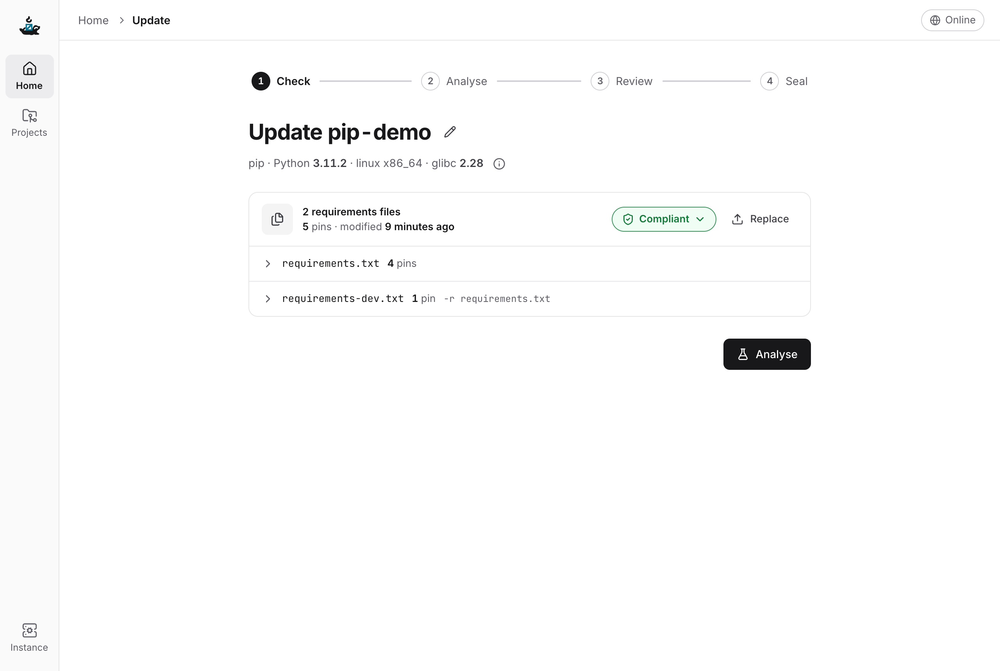
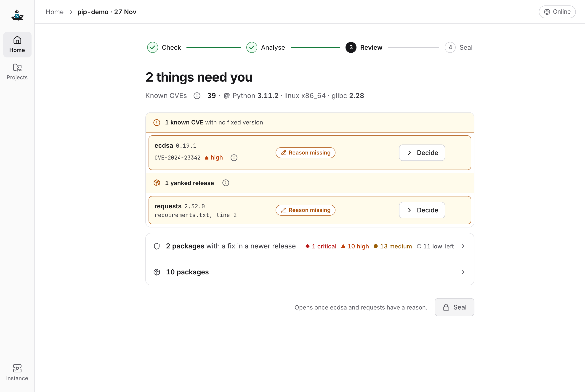
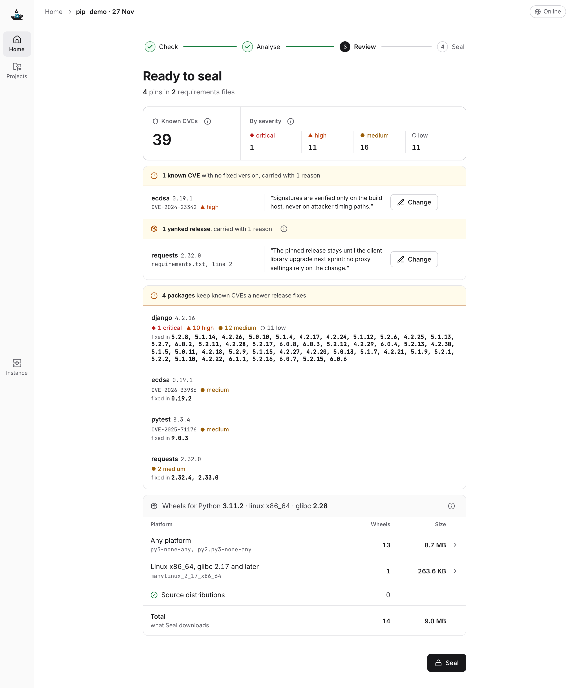
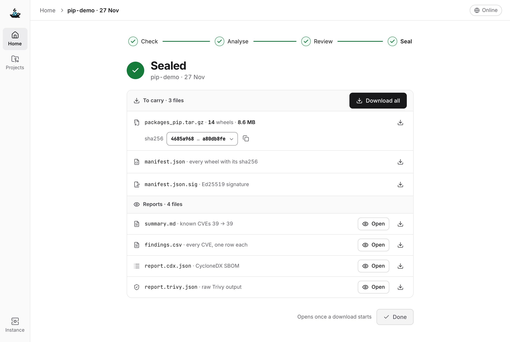

# Python projects

sealift carries Python packages across the air gap as it carries npm packages: it resolves a project's requirements files, scans the set for known CVEs, packs the wheels in a signed archive, and the import publishes them to a pypi hosted repository in Nexus. This page follows one Python project from its files to an install on the air-gapped side. The connected side's screens cross a Python project in the same four steps as an npm one: Check, Analyse, Review and Seal. The import screens take Python archives as they take npm ones.

## What a project holds

A Python project holds one or more requirements files, resolved together for one target. Each file pins exact versions with `==`, and may include another file of the same project with `-r` or `-c`. A pin may carry `--hash=sha256:` options. sealift reads every file before it stores anything, and refuses:

- a range (`>=`, `~=`), a URL, a local path or any option other than `-r`, `-c` and `--hash`;
- the same package pinned at two versions in two files, naming both files;
- a file above 1 MiB, more than 32 files, or a file name it cannot store.

A refusal answers 400 with one entry per refused line and creates nothing. [The API](dev/api.md#pip-projects) gives every rule.

## The target

A project resolves for one target: a Python version, `linux`, `x86_64`, a glibc version, and the uv release that resolves. The default is Python 3.11.2 with glibc 2.28 and uv 0.13.7; the deployment's policy file can set another, under `targets.pip` ([Settings](settings.md#python-target)). Read the exact values on a machine of the air-gapped side:

<!-- illustrative -->
```sh
python3 -VV
ldd --version
```

The first line of each gives the Python version and the glibc version. Check shows the target on one line, such as `pip · Python 3.11.2 · linux x86_64 · glibc 2.28`. Its info button, What the target is, names the same two commands under Check on one of them.

sealift records one wheel per package for that target. A package with no wheel the target can install, such as one published as a source distribution only, shows in Review in a red block, such as 1 package with no wheel for the target, with the file and line that pin it. Seal stays disabled until the files change. When another package needs it and no wheel of its version installs on the target, the analysis fails and names it.

## Cross in the web

**Update** opens the drop zone: Drop a package.json or requirements files, and **Choose files**. Drop every requirements file of the project at once. Check lists one row per file, such as `requirements.txt 4 pins`, and asks the project's name in the title. Until it is written, the text before **Analyse** reads Name the project first.



Compliant opens on five checks, such as 5 checks passed:

| Check | What it asks |
| --- | --- |
| Exact versions | every pin uses `==` |
| PyPI only | no URL, path or other index |
| Supported options | `-r`, `-c` and `--hash` only |
| Included files | each file that `-r` or `-c` names is dropped too |
| One version each | the files agree on each package's version |

A failing check names each line as written, with its file and line.

**Analyse** opens the crossing on Analyse, which shows each step with its live log. Review then compares the set with the previous crossing of the same project, found by its name. With none, it counts the known CVEs alone. The title says what is left, such as 2 things need you, and the line under it reads Known CVEs, such as 39 to 25, then the target.



What holds **Seal** comes first: the red block of packages with no wheel, then the reasons, in three bands. A major jump since the previous crossing has **Jump**; a known CVE with no fixed version and a yanked release have **Decide**. Each panel holds the facts and a reason of 1 to 300 characters, with **Record**, and **Replace files** beside it. [How sealift chooses](how-sealift-chooses.md#reasons) lists the three reasons.

The other packages fall into groups, each a row with its count, such as 1 pin changed, 1 package added, 1 package with a fix in a newer release and 10 packages unchanged. With no previous crossing, the last group counts packages alone, such as 10 packages.

**Replace files** opens Update with the project's name kept: drop the changed files and press **Analyse** for a new crossing.

Once nothing waits, the title reads Ready to seal. The head counts the known CVEs by severity, and Wheels for Python 3.11.2 · linux x86_64 · glibc 2.28 lists what **Seal** downloads per platform, such as Any platform 13 wheels 8.7 MB, with Source distributions 0 and the total.



Sealed is the npm page with the wheels counted, such as `packages_pip.tar.gz · 14 wheels · 8.6 MB`, and the archive's fingerprint.



The lab ran this crossing at commit 30a417b on PyPI's live index: requests 2.32.0 is yanked and psycopg2 2.9.10 publishes Windows wheels only, so the first Review showed psycopg2 in the red block. The archive's sha256 matched the fingerprint, and the import of sealift 0.7.0 published its 14 wheels.

## Wheels

A wheel is a package built ahead for one Python version and platform, which pip installs without running any of its code. A source distribution runs code during its build, so none crosses. sealift picks one wheel per package for the target. A package with none fills the red block in Review, which names what the index publishes, such as Publishes wheels for other platforms only. Pin another version that has a wheel, or another package, then press **Replace files**.

## Yanked releases

The publisher of a release can yank it from the index, most often for a bug. pip still installs a yanked release when a file pins its exact version. Review lists each one under yanked release, and its **Decide** panel quotes the index's reason, or reads No reason given.

By default, a yanked release crosses with a reason written for it. The signed manifest carries the index's reason and yours, and `summary.md` lists the release. Under `review.yanked: refuse` ([Settings](settings.md#review-rules)), the band reads 1 yanked release, refused by this instance, and its row reads Refused by this instance's policy, with no reason to write. The text before **Seal** names the release, such as This instance refuses every yanked release: requests cannot cross. Pin another version, then press **Replace files**.

## Analyse and export through the API

The calls below go to a sealift that listens on `localhost:8080`. sealift installs the default pip target's uv at start, so create the project once `/healthz` answers 200: its first analysis starts at once. A target that names another uv version installs it during the analysis, under the same checks.

<!-- illustrative -->
```sh
curl -s -F ecosystem=pip -F name=my-service \
  -F requirements=@requirements.txt -F requirements=@requirements-test.txt \
  http://localhost:8080/api/projects
```

The answer gives the project's id. `GET /api/projects/<project-id>` lists its analyses. Follow the analysis until its state is `done`, then read `pipResult`: every package of the set with its wheel, its CVEs, and any package that blocks the export.

<!-- illustrative -->
```sh
curl -s http://localhost:8080/api/projects/<project-id>
curl -s http://localhost:8080/api/projects/<project-id>/analyses/<analysis-id>
```

Export the whole set. A Python export takes no selection:

<!-- illustrative -->
```sh
curl -s -X POST -H 'Content-Type: application/json' -d '{"selection":{}}' \
  http://localhost:8080/api/projects/<project-id>/analyses/<analysis-id>/exports
```

Follow the export until it is `done`, then download its files from `GET /api/projects/<project-id>/exports/<export-id>/files/<name>`. [The API](dev/api.md#pip-exports) describes each step and each answer.

## What crosses

Three files cross, as for npm: `packages_pip.tar.gz`, `manifest.json` and `manifest.json.sig`. Record the archive's sha256 on the connected side and send it by another channel. On the air-gapped side, the three files go to `packages/pip/<folder>/` in the user's MinIO bucket.

## Import

The import service lists `packages/pip/` beside `packages/npm/` and imports a Python archive the same way, into the repository that `nexus.pipRepository` names. [Importing](importing.md) covers the screens, and [the air gap](air-gap.md) the checks.

## Install on the air-gapped side

Install from the pypi repository's simple index, with wheels only:

<!-- illustrative -->
```sh
pip install --only-binary :all: \
  --index-url <nexus-url>/repository/<nexus-pypi-repository>/simple/ \
  -r requirements.txt -r requirements-test.txt
```

The lab ran an install at commit f5c6f46 with a project of two requirements files and 173 packages: the import published every wheel, and a Python 3.11.2 machine with no route to the internet installed the whole set from Nexus alone, with no broken requirement.

## Limits

- One wheel per package, for one target: `linux`, `x86_64` and glibc. No macOS, Windows or musl wheels.
- No source distribution: a package without a wheel for the target shows in Review's red block, and Seal stays disabled. One that another package needs stops the analysis.
