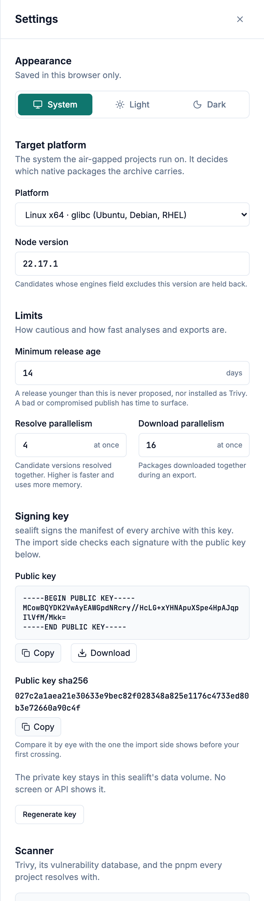

# Settings

This page describes each setting: what it changes, its range and its default. **Settings**, in the header, opens the panel over the current screen. A change to the limits applies to the next analysis or export; one that is running keeps the values it started with. A change to the target applies to sessions created after it: a session keeps the target it started with, retries included.



When a field changes, a bar at the bottom shows Unsaved changes, with **Save** and **Discard changes**. An invalid value shows its error under the field, and **Save** stays disabled.

## Appearance

System, Light or Dark. The choice is saved in this browser only, so each person using sealift keeps their own.

## Target platform

The system the projects run on, on the air-gapped side. pnpm resolves for it, so the archive carries the native packages that platform needs, such as the right `esbuild` binary.

### Platform

| Choice | For |
| --- | --- |
| Linux x64 · glibc | Ubuntu, Debian, RHEL. The default |
| Linux arm64 · glibc | Ubuntu, Debian on ARM servers |
| Linux x64 · musl | Alpine |
| Linux arm64 · musl | Alpine on ARM |

### Node version

The Node version the projects run with, as an exact version such as `22.17.1`. The default is `22.17.1`. A candidate whose `engines.node` excludes it gets the `node-mismatch` signal and is never proposed. [How sealift chooses](how-sealift-chooses.md#signals) lists the signals.

### pnpm

Read-only, under Scanner. This release of sealift uses pnpm `10.34.5`, and picks it when it starts. Every project resolves with it.

## Signing key

sealift signs the manifest of every archive with an Ed25519 key. It generates the key pair on its first start and keeps the private key in its data volume, in `private/signing-key.pem`. No screen, API answer, log line or exported file shows the private key. The import side checks each signature with the public key and refuses an archive signed by any other.

The section shows two values:

- **Public key** is the PEM block, with **Copy** and **Download**. The download is a file named `sealift-public-key.pem`. Carry it once to the import side, over a channel you trust, and name it in the import's `publicKeyFile` setting. [Deployment](deployment.md#the-key-the-import-trusts) shows where it goes.
- **Public key sha256** is the sha256 of the key, in full, with **Copy**. The import side shows the same value in its own Settings. Compare the two by eye before your first crossing: equal values mean the import side holds the key you carry from.

**Regenerate key** asks Regenerate the signing key? first. Confirming replaces the key pair. **Keep the current key**, or Escape, leaves it. After a regenerate, the import side refuses every new archive until it holds the new public key, and it refuses the archives you exported before, which carry the old signature. Carry the new public key before your next crossing.

The key lives in the volume. Delete the volume, or `private/signing-key.pem`, and the next start generates another key, which the import side must receive. A key file that exists and cannot be read, is not a PEM private key or is not Ed25519 stops sealift at start with the file's name: it never replaces a key by itself.

## Limits

### Minimum release age

How many days a release must be public before sealift proposes it, or installs it as Trivy. From 1 to 90 days, 14 by default. A bad or compromised publish has time to surface. [How sealift chooses](how-sealift-chooses.md#the-minimum-release-age) explains the wait.

### Resolve parallelism

How many candidate versions the analysis resolves at once. From 1 to 16, 4 by default. Higher is faster and uses more memory: each resolution is one pnpm process.

### Download parallelism

How many packages an export downloads at once. From 1 to 32, 16 by default. Lower it when the registry or a proxy limits connections.

## Scanner

Trivy, its vulnerability database, and pnpm, with their versions.

- **Update Trivy** installs the latest Trivy release and reports it, or says the installed one is already the newest. When the latest is younger than the minimum release age, it refuses and offers **Install anyway**. Earlier versions stay installed under Also installed, to roll back to, each with **Use this version**.
- **Update database** downloads the latest vulnerability database and shows its date. sealift also refreshes it before each analysis.

## Review rules

Three rules decide what an export needs before it crosses. The deployment sets them under `review` in the policy file that `SEALIFT_POLICY` names, and no control in the panel changes them:

```yaml
review:
  proposeOtherMajors: false
  majorJump: reason
  cveWithoutFix: reason
```

| Key | Values | Default | What it changes |
| --- | --- | --- | --- |
| `review.proposeOtherMajors` | `true`, `false` | `false` | With `true`, an analysis may propose a version outside the dependency's current line, as sealift 0.7.0 did |
| `review.majorJump` | `reason`, `refuse` | `reason` | An export that takes a version outside its line needs a reason, or is refused whatever reason it holds |
| `review.cveWithoutFix` | `reason`, `refuse` | `reason` | An export whose archive holds a version with a CVE that no version fixes needs a reason, or is refused |

A key the file leaves out keeps its default. Any other value stops sealift at start with the key and the values it takes, such as `review.majorJump must be one of reason, refuse`. The rules apply to every analysis and export after the start. An analysis keeps the proposals it made under the rule of its time: a new analysis applies a changed `review.proposeOtherMajors`. `GET /api/instance` reports the three rules under `policy.review`. [How sealift chooses](how-sealift-chooses.md#reasons) explains the line and the reasons.

## From the API

The panel reads and writes `/api/settings`. The signing key has its own routes, which [the API reference](dev/api.md#signing-key) describes. `GET` returns every setting:

<!-- run -->
<!-- expect: "minReleaseAgeDays":14 -->
```sh
curl -s http://localhost:8080/api/settings
```

```json
{"downloadParallelism":16,"minReleaseAgeDays":14,"resolveParallelism":4,"target":{"cpu":"x64","libc":"glibc","node":"22.17.1","os":"linux","pnpmVer":"10.34.5"}}
```

`PUT` replaces every setting at once, so send them all. A value out of range answers 400 and names it:

<!-- run -->
<!-- expect: download parallelism must be between 1 and 32, not 1000 -->
```sh
curl -s -X PUT http://localhost:8080/api/settings \
  -H 'content-type: application/json' \
  -d '{"downloadParallelism":1000,"minReleaseAgeDays":14,"resolveParallelism":4,"target":{"cpu":"x64","libc":"glibc","node":"22.17.1","os":"linux","pnpmVer":"10.34.5"}}'
```

```json
{"detail":"invalid limits: download parallelism must be between 1 and 32, not 1000","status":400,"title":"update settings","type":"about:blank"}
```
