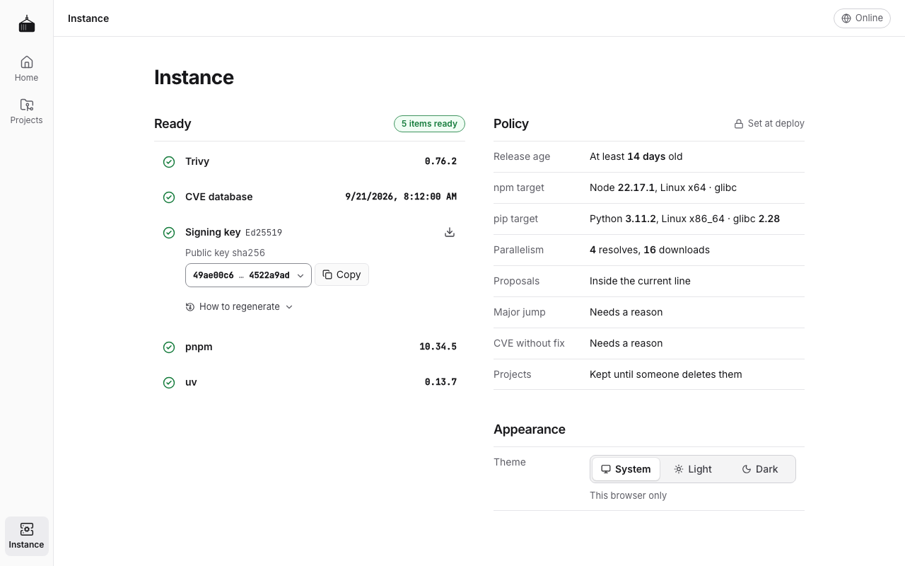

# Settings

This page describes the policy file: each key, its default and its range, the brand, and how the file meets the settings an older release saved. It then covers the **Instance** page, which shows the readiness, the policy in effect and the signing key.

The deployment sets the policy. No screen or API route changes it: edit the file and restart sealift. A new target applies to sessions created after the restart, and a session keeps the target it started with, retries included.

## The policy file

`SEALIFT_POLICY` names the file. Unset, sealift reads none and every value takes its default. sealift reads the file once, at start. The file is YAML, and every key is optional:

<!-- illustrative -->
```yaml
targets:
  npm:
    os: linux
    cpu: x64
    libc: glibc
    node: 22.17.1
    pnpm: 10.34.5
  pip:
    python: 3.11.2
    os: linux
    cpu: x86_64
    glibc: "2.28"
    uv: 0.13.7
minReleaseAgeDays: 14
parallelism:
  resolve: 4
  download: 16
brand:
  name: sealift
  logo: logo.svg
  accent: "#0b6e99"
  sides:
    online: Online
    offline: Offline
  reviewWord: PR
  contact:
    label: Platform team
    url: mailto:platform@example.com
```

`deploy/connected/policy/policy.yaml` holds the same keys, each one commented out, and `deploy/connected/compose.policy.yaml` mounts its folder. [Deployment](deployment.md#the-policy-file) shows how.

| Key | Default | Accepted |
| --- | --- | --- |
| `targets.npm` | Linux x64 glibc, Node 22.17.1, pnpm 10.34.5 | all five fields, or none |
| `targets.pip` | Linux x86_64, glibc 2.28, Python 3.11.2, uv 0.13.7 | all five fields, or none |
| `minReleaseAgeDays` | 14 | 1 to 90 |
| `parallelism.resolve` | 4 | 1 to 16 |
| `parallelism.download` | 16 | 1 to 32 |
| `brand.name` | `sealift` | 1 to 40 characters |
| `brand.logo` | none | a PNG or SVG file of at most 256 KiB |
| `brand.accent` | none | a colour written `#rrggbb` |
| `brand.sides.online` | `Online` | 1 to 20 characters |
| `brand.sides.offline` | `Offline` | 1 to 20 characters |
| `brand.reviewWord` | `PR` | 1 to 12 characters |
| `brand.contact.label` | none | 1 to 60 characters, with `url` |
| `brand.contact.url` | none | an `https:` or `mailto:` address of at most 512 bytes, with `label` |

### When the file is refused

sealift refuses to start on a file that is missing, unreadable, larger than 64 KiB, not a regular file or not valid YAML, and on a key it does not know or a value outside its range. The log's last line, `sealift stopped`, carries an error that names the file, the key and the rule:

```
policy /etc/sealift/policy.yaml: minReleaseAgeDays must be between 1 and 90, not 120
```

An unknown key is named in full, with its line: `brand.colour is an unknown key (line 4)`. Fix the file and start sealift again.

## Target platform

The system the projects run on, on the air-gapped side. pnpm resolves for it, so the archive carries the native packages that platform needs, such as the right `esbuild` binary. `targets.npm` sets it for npm sessions. A target is whole: a file that sets `targets.npm` sets all five fields, and one that leaves a field out is refused with the list of fields.

### Platform

| `os`, `cpu`, `libc` | For |
| --- | --- |
| `linux`, `x64`, `glibc` | Ubuntu, Debian, RHEL. The default |
| `linux`, `arm64`, `glibc` | Ubuntu, Debian on ARM servers |
| `linux`, `x64`, `musl` | Alpine |
| `linux`, `arm64`, `musl` | Alpine on ARM |

### Node version

`node` is the Node version the projects run with, as an exact version such as `22.17.1`. A range such as `22` or `22.x` is refused. A candidate whose `engines.node` excludes it gets the `node-mismatch` signal and is never proposed. [How sealift chooses](how-sealift-chooses.md#signals) lists the signals.

### pnpm

`pnpm` is the default pnpm version, as an exact version: an npm session resolves with it unless its project's target names another. sealift downloads it at start from the npm registry and checks it against the integrity the registry publishes.

### Python target

`targets.pip` is the target a pip project gets when its creator names none. `python` is `3.<minor>.<patch>`, `os` is `linux` and `cpu` is `x86_64`, the only ones for now. `glibc` goes from `2.17` to `2.40`; quote it, so YAML reads `"2.28"` as text. `uv` is an exact version, which sealift downloads at start. [Python projects](python.md) shows how to read these values on the target machine.

## Limits

### Minimum release age

`minReleaseAgeDays` is how many days a release must be public before sealift proposes it. From 1 to 90 days, 14 by default. A bad or compromised publish has time to surface. The start holds uv to the same age. [How sealift chooses](how-sealift-chooses.md#the-minimum-release-age) explains the wait.

### Resolve parallelism

`parallelism.resolve` is how many candidate versions the analysis resolves at once. From 1 to 16, 4 by default. Higher is faster and uses more memory: each resolution is one pnpm process.

### Download parallelism

`parallelism.download` is how many packages an export downloads at once. From 1 to 32, 16 by default. Lower it when the registry or a proxy limits connections.

## Brand

The brand names the instance and its two sides. This release reads and checks it at start and serves it through `GET /api/instance` and `GET /api/instance/logo`. The Online side draws it: the name titles the browser tab, the logo sits at the top of the sidebar in place of sealift's mark, the side label in the top bar reads `brand.sides.online`, and the accent outlines the home's lead card and marks the current place. The import service does not read the policy file, so its screens show the defaults: sealift's mark, `Offline` and no accent.

- `brand.logo` is a path relative to the policy file's folder. It must be a regular file: a link or a FIFO is refused. sealift recognises a PNG by its signature and an SVG by its root element, refuses any other type, and reads the file once at start. The logo route serves those bytes with a `Content-Security-Policy` that blocks scripts, and `X-Content-Type-Options: nosniff`.
- `brand.accent` is checked for its form only. The screens use it where it reaches a contrast of 3:1 against the page, light and dark measured apart, and draw the ink in its place where it does not. The Instance page gives both ratios.
- `brand.contact` takes both `label` and `url`. The address starts with `https:` or `mailto:`, and an `https:` address names a host and carries no user name.
- A text value must not be blank, and must hold no control or formatting character, such as a line break or a direction mark.

A refusal names the key: `brand.accent must be a colour written #rrggbb`, `brand.logo must be a PNG or SVG file`, `brand.contact.url must be an https: or mailto: address`.

## Settings saved by 0.7.0

Up to 0.7.0, the settings form saved the target, the minimum release age and both parallelism values in `private/settings.json`, on the volume. sealift now reads that file and never writes it, and a new volume holds none. Each value comes from the policy file first, then from that file, then from the default. An upgraded instance with no policy file keeps every value it saved.

The start log names each key the policy file changes from a saved value, with the message `policy overrides a stored setting` and the key, such as `"key":"minReleaseAgeDays"`. A saved value of zero, which the first releases accepted, takes the default, and the log says `default replaces an empty stored setting` with the key. A saved value that this release refuses stops the start. The error names the file and the policy key that replaces the value:

```
/data/private/settings.json, left by an older release: minReleaseAgeDays must be between 1 and 90, not 120; set minReleaseAgeDays in the policy file to replace it
```

The file stays on the volume, so 0.7.0 still reads it after a rollback. 0.7.0 then uses the values saved there, whatever the policy file set.

## The Instance page

**Instance**, at the bottom of the sidebar, opens the page. `/settings`, the old address, leads there. Nothing on it edits the policy. It holds three sections:

| Section | Shows |
| --- | --- |
| Ready | Each item the start prepares, with its state: Trivy, CVE database, Signing key, pnpm and uv. A count above the list reads `5 items ready`. When the database refresh failed and an older database serves, it reads `4 items ready` and `1 warning` |
| Policy | `Set at deploy`, then one row per rule: Release age, npm target, pip target, Parallelism, Proposals, Major jump, CVE without fix, and Projects, which says whether the instance keeps its projects or erases them once idle (Ephemeral mode) |
| Appearance | Theme, with System, Light and Dark, saved in this browser only, so each person using sealift keeps their own. Accent, when the policy sets one, with its contrast ratio in each theme |



While a database refresh fails, **Instance** in the sidebar carries a warning mark, and its tooltip gives the cause and the date of the database in use.

### Signing key

sealift signs the manifest of every archive with an Ed25519 key. It generates the key pair on its first start and keeps the private key in its data volume, in `private/signing-key.pem`. No screen, API answer, log line or exported file shows the private key. The import side checks each signature with the public key and refuses an archive signed by any other.

The key's row sits in the Ready list, between the CVE database and pnpm:

- The download button, **Download public key**, saves the PEM block as `sealift-public-key.pem`. Carry it once to the import side, over a channel you trust, and name it in the import's `publicKeyFile` setting. [Deployment](deployment.md#the-key-the-import-trusts) shows where it goes.
- **Public key sha256** shows the first and last eight characters of the key's sha256. A press opens the whole value in groups of eight, and the copy button beside it copies all 64 characters. The import side's Instance page shows the value it trusts, with **Compare**: paste this one there before your first crossing. [Importing](importing.md#the-trusted-key) describes the comparison.
- **How to regenerate** opens one line, In the container or pod, and the command `sealift signing-key regenerate` with a copy button. The page itself has no control that changes the key. [The key the import trusts](deployment.md#the-key-the-import-trusts) says what a new key means for the import side.

The key lives in the volume. Delete the volume, or `private/signing-key.pem`, and the next start generates another key, which the import side must receive. A key file that exists and cannot be read, is not a PEM private key or is not Ed25519 stops sealift at start with the file's name: it never replaces a key by itself.

## Review rules

Three rules decide what an export needs before it crosses. The deployment sets them under `review` in the policy file that `SEALIFT_POLICY` names, and no control on the Instance page changes them:

```yaml
review:
  proposeOtherMajors: false
  majorJump: reason
  cveWithoutFix: reason
```

| Key | Values | Default | What it changes |
| --- | --- | --- | --- |
| `review.proposeOtherMajors` | `true`, `false` | `false` | With `true`, an analysis may propose a version outside the dependency's current line, as sealift 0.7.0 did |
| `review.majorJump` | `reason`, `refuse` | `reason` | An export that takes a version outside its line needs a reason, or is refused whatever reason it holds |
| `review.cveWithoutFix` | `reason`, `refuse` | `reason` | An export whose archive holds a version with a CVE that no version fixes needs a reason, or is refused. A pip export takes no reasons: under `refuse`, it is refused with 409 when its set holds such a CVE |

A key the file leaves out keeps its default. Any other value stops sealift at start with the key and the values it takes, such as `review.majorJump must be one of reason, refuse`. The rules apply to every analysis and export after the start. An analysis keeps the proposals it made under the rule of its time: a new analysis applies a changed `review.proposeOtherMajors`. `GET /api/instance` reports the three rules under `policy.review`. [How sealift chooses](how-sealift-chooses.md#reasons) explains the line and the reasons.

## From the API

`GET /api/settings` returns the npm target and the three limits in effect, read-only:

<!-- run -->
<!-- expect: "minReleaseAgeDays":14 -->
```sh
curl -s http://localhost:8080/api/settings
```

```json
{"downloadParallelism":16,"minReleaseAgeDays":14,"resolveParallelism":4,"target":{"cpu":"x64","libc":"glibc","node":"22.17.1","os":"linux","pnpmVer":"10.34.5"}}
```

`GET /api/instance` returns the whole policy, the pip target included, with the brand and the preparation. [The API reference](dev/api.md#instance) describes it. The signing key has its own routes, under [Signing key](dev/api.md#signing-key).
