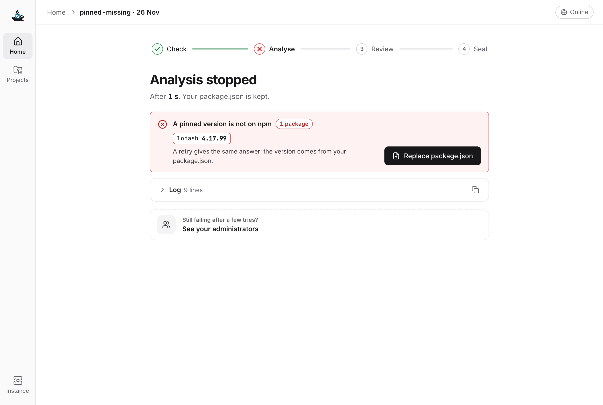

# Troubleshooting

This page lists the messages sealift shows, grouped by where they appear, with their cause and their fix. Search the page for the words on your screen.

When an analysis or a seal stops, one block names the cause and the action that clears it. The log, folded under the block, holds what pnpm and Trivy wrote, including their own error codes, which the block leaves out.

## Anywhere

### sealift is not reachable

On the home screen, the same problem reads Could not reach sealift.

The browser sent a request and got no answer. The container is stopped, restarting, or the reverse proxy in front of it is down.

Check the container with `docker ps` and its log with `docker logs sealift`, then try again.

### Progress stalls, then jumps to the end

A reverse proxy buffers the event stream. Turn buffering off for sealift: [Deployment](deployment.md#reverse-proxy) has the Caddy and Nginx settings.

## Start and preparation

These causes show on the Preparing this instance page, under the item that failed, and in `GET /api/instance`. sealift tries the item again every minute, so a fix outside sealift needs no restart. The log carries the same cause.

### could not reach GitHub to look up Trivy releases

sealift asks `api.github.com` for the pinned Trivy release before it downloads it. The machine has no route to GitHub, a firewall blocks it, or GitHub answers `403` because many users share your outbound address. Open the hosts [Deployment](deployment.md#outbound-access) lists, or set `SEALIFT_GITHUB_TOKEN`.

### trivy asset checksum mismatch

The Trivy archive sealift downloaded does not match the sha256 built into sealift. The message gives both digests. sealift installs nothing and keeps the instance not ready. If the mismatch stays, something between you and GitHub alters the download, or the mirror in `SEALIFT_GITHUB_API` serves other bytes.

### vulnerability database download

Trivy could not download its database from `mirror.gcr.io`, and the volume holds none, so the instance stays not ready. The message ends with Trivy's last line. Open that host.

### could not refresh the vulnerability database

The refresh at start failed while an older database is on the volume. The instance is ready and scans with that database; the warning in `GET /api/instance` gives its date and the cause.

### uv was uploaded under the minimum release age

The uv version the default pip target names is younger than `minReleaseAgeDays`, so sealift refuses to install it, and pip projects cannot run. Set `targets.pip.uv` in the policy file to an older uv, or wait until the release is old enough. [Settings](settings.md#python-target) describes the key.

### tools not ready

The API answers 409 to a new session or analysis while Trivy or its database is missing, and lists which one. Wait until `/healthz` answers 200.

### policy

The policy file holds an unknown key, a value outside its range, or cannot be read. sealift does not start. The log's last line names the file, the key and the rule, such as `policy /etc/sealift/policy.yaml: minReleaseAgeDays must be between 1 and 90, not 120`. Fix the file and start again. [Settings](settings.md#when-the-file-is-refused) lists the keys and their ranges.

### left by an older release

The settings 0.7.0 saved in `private/settings.json` hold a value this release refuses. sealift does not start, and the message names the policy key that replaces it, such as `set minReleaseAgeDays in the policy file to replace it`. Set that key in the policy file and start again.

## Check

### 3 issues, and 3 checks to fix first

Check found entries sealift refuses. Each failed check names its packages or fields with their values:

| Check | Fix |
| --- | --- |
| Exact versions, such as 1 of 2 is a range | Replace the range or tag with the version the project uses today |
| Registry only, such as 1 of 2 off npm | Replace the alias, Git URL or path with a registry version |
| Supported fields, such as 1 field not supported | Remove `overrides`, `resolutions`, `pnpm.overrides` or `pnpm.patchedDependencies` |

A file with no dependency reads The file lists no dependency. Drop a `package.json` with at least one.

The API gives the same answer to a file sent directly:

<!-- run -->
<!-- expect: version must be exact, such as 1.2.3 -->
```sh
printf '{"name":"demo","dependencies":{"express":"^4.17.1"}}' > /tmp/range.json
curl -s -F manifest=@/tmp/range.json http://localhost:8080/api/projects
```

```json
{"detail":"the manifest has entries sealift cannot analyze","errors":[{"field":"dependencies","name":"express","reason":"version must be exact, such as 1.2.3","value":"^4.17.1"}],"status":400,"title":"invalid package.json","type":"about:blank"}
```

### The file is not valid JSON.

The dropped file does not parse. Check that you dropped the `package.json` itself, not a lockfile or another file.

### The file holds JSON, but not an object like a package.json.

The file parses, but holds an array, a string or a number at its top level.

## Analyse

When an analysis stops, the screen reads Analysis stopped, and its block names one of four causes.

### A pinned version is not on npm

pnpm found no such version on the registry (`ERR_PNPM_NO_MATCHING_VERSION` in the log). The block names the package and the version, such as lodash 4.17.99. A retry gives the same answer, since the version comes from your `package.json`. Fix the version, then press **Replace package.json** and drop the file again.



### No answer from registry.npmjs.org

A fetch timed out, was refused, or found no host. The title names the host from the message, or reads No answer from the registry. The file is not the cause. Check that sealift reaches the registry, or the mirror set in [Deployment](deployment.md#outbound-access), then press **Retry**.

### The vulnerability database did not download

The scan needs Trivy's database, and its download failed. The file is not the cause. Press **Retry**; when it fails again, see [vulnerability database download](#vulnerability-database-download).

### Any other cause

The block's title is the first line of the tool's message, such as a package name pnpm does not find (`ERR_PNPM_FETCH_404`): sealift reads the public registry, or the mirror set in [Deployment](deployment.md#outbound-access). The log holds the whole message. Fix what it names, then press **Retry**.

### The cause was not recorded

A release before this one kept no cause for a failed analysis. The block names the step it stopped at; the log has what the tools wrote. Press **Retry**.

### fork/exec /usr/local/bin/node: operation not permitted

sealift could not start pnpm as its `tools` user. The container runs with `no-new-privileges`, set by the Compose file or by the Docker daemon for every container, or without the `SETUID` and `SETGID` capabilities. `docker exec <container> grep NoNewPrivs /proc/1/status` must print `0`. [Deployment](deployment.md#compose) has a setup that works.

### An analysis shows Analysis interrupted after a restart

The server was killed while the analysis ran: a crash, or a stop that outlasted the grace period. The session keeps the analysis, marked interrupted, with the log of the steps it reached. Start the analysis again. A normal stop, such as `docker stop` or a compose recreate during an upgrade, ends the running analysis as Analysis stopped instead. Start it again too. Some analyses are not kept: one still waiting in the queue, one whose status file is damaged, and any the server could not mark because `/data` was not writable at startup. Start those again.

### A package with known CVEs shows under unchanged

No candidate it could propose has fewer CVEs: the ones that would are too recent, excluded by the Node version, deprecated or fail to resolve. sealift keeps the package at its current version. [How sealift chooses](how-sealift-chooses.md#signals) explains each one.

## Seal

### jobs: sign manifest.json

The export packed the archive but could not sign its manifest. The seal reads Sealing stopped, It stopped while signing the manifest and writing the reports, and offers no file to download. The message after the colon names the cause. Retry once; if it fails again, check the log of the container for the signing key's own message, described under [store: signing key cannot be read](#store-signing-key-cannot-be-read).

### Signed with a key this instance has replaced

Sealed, or a project's page, says Signed with a key this instance has replaced: the key changed after the seal, by `sealift signing-key regenerate`. The import refuses the archive once it trusts the new key. Open Review from the step bar, press **Seal** again, and carry the new files.

### Not signed: sealift 0.4.0 or earlier exported this archive

The archive was exported before signing existed. The import refuses it as unsigned. Export the selection again with this version.

### Could not read manifest.json.sig

Sealed could not read the signature file of an export. The file is missing or damaged in the volume. Export the selection again.

### jobs: the export selects no version and leaves out the current project, so it would pack nothing

The selection keeps every dependency at its current version, so the archive would be empty. Choose at least one new version in the review.

```json
{"detail":"jobs: the export selects no version and leaves out the current project, so it would pack nothing","status":400,"title":"queue export","type":"about:blank"}
```

### invalid export selection

The selection names a version the analysis did not resolve. This happens through the API, not through the review. The answer names each version:

```json
{"detail":"the selection names versions the analysis did not resolve","errors":[{"field":"selection","name":"express@9.9.9","reason":"not a version the analysis resolved"}],"status":400,"title":"invalid export selection","type":"about:blank"}
```

### jobs: downloaded tarball does not match its recorded integrity, possible tampering

A downloaded package does not match the sha512 the registry published. sealift stops and packs nothing. Retry once; if it fails again, a proxy or mirror between sealift and the registry serves altered files. Do not work around it.

### It stopped while downloading and verifying each package.

The export could not download a package. The message and the log name it. A registry or proxy that times out or limits connections is the usual cause: lower [download parallelism](settings.md#download-parallelism), then **Retry**.

## Start

### store: ... must be a directory, not a link

sealift exits at start because `projects/` in its data directory is a symbolic link. sealift opens that folder once and serves the files of an analysis or an export from inside it, so it refuses a link there. Mount the other disk or volume at `projects/` itself, then start sealift again.

### store: signing key cannot be read

sealift stops at start, naming the file, when `private/signing-key.pem` exists in the data volume and cannot be read, is not a regular file, is not a PEM private key or is not an Ed25519 key. The messages read `store: signing key <path> cannot be read`, `store: signing key <path> is not a regular file`, `store: signing key <path> is not a PEM private key` and `store: signing key <path> is not an Ed25519 key`. sealift never replaces the file by itself, because a silent new key would make the import side refuse every archive.

For `cannot be read`, the key is usually intact and the file's owner or mode is wrong, as after a volume restored or copied by another user. Stop sealift, then give `private/signing-key.pem` to the user the image runs as, `app` (uid 10000), with mode 0600 inside `private/` at mode 0700 (`chown 10000:10000` and `chmod 0600`), and start again. Do not remove the file: it is the only copy of the private key.

For `is not a regular file`, a link, a directory or a device sits at the key's name. Put the key file itself there.

A key damaged while sealift runs does not stop it. `/healthz` answers 503 with `signing-key` among the items not ready, and every export fails before its first download, with the same message on screen. Fix the file as below; sealift reads it again when it changes.

For `is not a PEM private key` or `is not an Ed25519 key`, the file is damaged or foreign. Restore it from a backup of the volume. When there is none, remove `private/signing-key.pem` by hand and start again: sealift generates a new key, and you carry its public key to the import side before the next crossing. [Deployment](deployment.md#the-key-the-import-trusts) covers a lost volume.

## Import

These messages come from `sealift import` (exit code 3 for a refusal, 2 for a settings error) and from the import service, which shows a refusal as the cause on the import's page. Nothing was published in any of them. [Archive format](dev/archive-format.md#what-sealift-import-checks) describes the check order.

### the archive is unsigned

The full reason reads `the archive is unsigned: manifest.json.sig is missing beside the manifest. Export it again with sealift 0.6.0 or later and carry the archive, manifest.json and manifest.json.sig together`. Either the signature file did not cross with the archive, or sealift 0.4.0 or earlier exported the archive. Carry `manifest.json.sig` beside the manifest, or export again. With `-signature`, the name in the message is the file you passed. In the service, an archive without the signature in its folder is listed as Cannot be imported, with `no manifest.json.sig in its folder`.

### manifest.json.sig is not a signature this import reads

The reason ends with the first rule the file breaks: it is larger than 4096 bytes, it is not a JSON object, its algorithm is not ed25519, its `publicKeySha256` is not 64 lowercase hex digits, or its signature is not base64 of exactly 64 bytes. The file was cut, edited or replaced by another file in transit. Carry `manifest.json.sig` again from the connected side.

### the manifest is signed by another key

The full reason reads `the manifest is signed by another key, public key sha256 <named>; this import trusts <trusted>. If the connected side regenerated its key, carry its new public key here; otherwise export the archive again`. The two values are the sha256 of the key that signed and of the key the import trusts. Compare the first with the Public key sha256 on the connected side's Instance page. When they are equal, someone ran `sealift signing-key regenerate` on the connected side: carry its new public key to the file `publicKeyFile` names, and start the import again. When they differ, this archive came from another sealift: do not import it.

### the signature does not match the manifest

The full reason reads `the signature does not match the manifest: manifest.json or manifest.json.sig changed after the export. Carry both again from the connected side`. The signature names the trusted key, and the check fails: a byte of the manifest or of the signature changed after the export. Do not edit either file. Carry both again, and check them with the sha256 you keep from the connected side.

### formatVersion is missing, or is not 2 or 3

The signature verified, but the manifest names no format, or a format this import does not read: 2 for npm, 3 for pip. Export the selection again with a sealift of the same release as the import.

### MinIO could not list packages/pip/

**Archives** shows `MinIO could not list packages/pip/: ` followed by MinIO's reason, and still lists `packages/npm/`. The import service's MinIO user has a policy that covers `packages/npm/` alone, as before sealift imported Python packages. Ask the administrators to extend it as [the request](admin-request.md#minio) gives it; nothing else changes.

### the settings name no pip repository

The archive is a pip archive and the settings file has no `nexus.pip` section, so the import refuses it before reading it. Set `nexus.pip.repository` to the pypi hosted repository, or `nexus.pipRepository` in the chart's values, and start the import again.

### publicKeyFile is required, or cannot be read

The import and the service start only with a trusted key. They exit with code 2 and one line naming the field when `publicKeyFile` is absent from the settings file (`publicKeyFile is required`), the file does not exist or cannot be read, is larger than 4096 bytes, or does not hold exactly one Ed25519 `PUBLIC KEY` PEM block (`publicKeyFile is not one Ed25519 PUBLIC KEY PEM block: ...`, ending with the problem). Download the key again from the connected side's Instance page, or take it from `GET /api/signing-key`, and save the whole block, `-----BEGIN PUBLIC KEY-----` to `-----END PUBLIC KEY-----`, in the file. LF and CRLF line endings both work.

### signatureKeyFile is an unknown field

A settings file written for 0.4 still holds `signatureKeyFile`. Remove the line and add `publicKeyFile`, as [The air gap](air-gap.md#the-import) shows.

## Reporting a problem

When none of this helps, open an issue with the sealift version (in `summary.md`, or the image tag), the target platform, the message on screen, and the log from **Show the log**. Remove any private package name first. The private signing key never appears in the log, and no one needs to send it.
