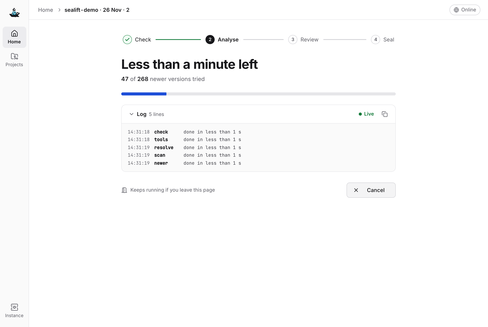
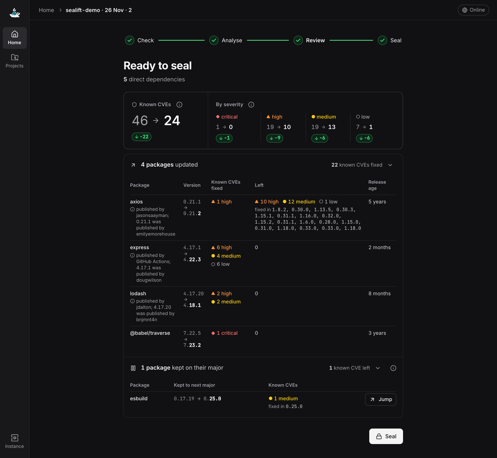
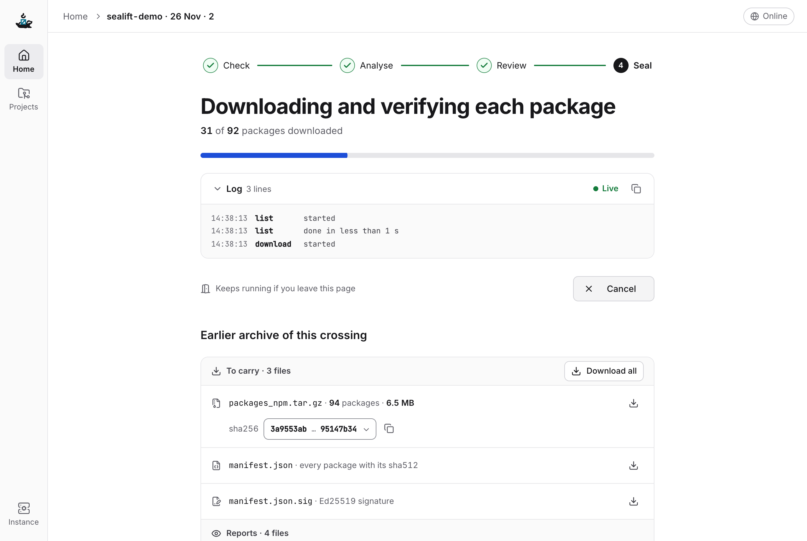

# Workflow

This page walks through each screen of the connected side, in order, with the label of every button: the frame around them, the home, Projects, then each step of a crossing. A crossing is one analysis of a project's `package.json` and the archives built from it.

## The frame

Every screen but the preparing one sits in the same frame. The sidebar on the left holds the places, **Home** and **Projects**, and **Instance** at its foot. The current place is highlighted. The top bar holds the breadcrumb, such as Home, then the crossing's name, and the side label on the right, a globe with `Online`. The deployment's brand can rename the side and replace the mark at the top of the sidebar: [Settings](settings.md#brand) lists its keys. **Skip to content**, the first stop of the keyboard, jumps past the sidebar.

A crossing is named after its project and the day its analysis started, such as `sealift-demo · 25 Nov`. A second analysis of the same project on the same day reads `sealift-demo · 25 Nov · 2`.

A crossing lives at one address, `/crossings/<project>`. `?analysis=<id>` opens an earlier analysis of the project, and `?step=check` or `?step=review` opens that step. An address of an earlier release, `/sessions/<project>` with or without its step, lands on the same crossing at the step it named.

The step bar at the top of a crossing shows Check, Analyse, Review and Seal. A finished step shows a check mark and opens again on a click. A running step shows a spinner, a failed one a cross, and a cancelled one a dotted ring.

An info button beside CVE, a severity or major jump explains the term in two sentences, with **Read more** to its section of How sealift chooses: [Known CVEs](how-sealift-chooses.md#known-cves), [Severity](how-sealift-chooses.md#severity) or [Major jump](how-sealift-chooses.md#major-jump). Each screen carries one per term, at the term's first place.

## Preparing

While the instance prepares, the home shows Preparing this instance, with the count of items ready. sealift prepares each item on its own at start, and the screen has no button:

| Item | Where it comes from |
| --- | --- |
| Trivy and its version | `github.com/aquasecurity/trivy`, the release the binary pins, checked against the sha256 built into sealift |
| CVE database | `mirror.gcr.io`, updated every six hours upstream; sealift refreshes it before each analysis |
| Signing key | sealift: an Ed25519 key it generated for this volume, shown with its public key sha256 |
| pnpm and its version | the npm registry, checked against the integrity it publishes. It resolves npm projects |
| uv and its version | the package index, checked against the sha256 it publishes. It resolves pip projects |

Each item reads Preparing, Ready or Failed. A failed item shows its cause and Next try in, with the time left; sealift tries again every minute. The home opens once every item is ready, with no reload. [Deployment](deployment.md#readiness) explains readiness for whoever runs the instance.

## Home

The home opens on Start a crossing, with one card, **Update** a project. Below it, two groups list the latest crossing of each project, newest first:

| Group | Holds | Row's action |
| --- | --- | --- |
| Needs you | A crossing whose review waits (Review waits), a failed one (Failed at Analyse, Failed at Seal), and a project dropped but never analysed (Not analysed yet) | **Review** for a waiting review, **Open** otherwise |
| In progress | A crossing queued (Queued), analysing (Analysing) or building its archive (Sealing) | **Open** |

A sealed or cancelled crossing leaves the home: Projects keeps it. A group shows ten rows, then **Show all**, such as Show all 12 crossings. While a crossing runs, the home reads the list again every 5 seconds, so a finished one leaves In progress by itself. Before the first crossing, In progress reads No crossing in progress.

## Update

**Update** opens Update a project, with the drop zone: Drop a package.json, and **Choose file**. A dropped file opens the Check step.

## Projects

**Projects** lists every project with its latest crossing. The title counts them, such as `3 projects`. Each row shows the project, its ecosystem, its latest crossing and that crossing's state. From two projects on, **Latest** and **Name** order the list: newest crossing first, 15 rows and then **Show all**, such as Show all 16 projects, or by name under a heading per letter. With no project, the page reads No project yet, and **Update a project** opens the Update page.

A project's page shows its name, its target and its crossings, newest first, such as `3 crossings`, or No crossing yet. A sealed crossing opens on two lists:

- To carry: the archive, `manifest.json` and `manifest.json.sig`, each with its download, and **Download all** for the three. The archive's row shows its sha256, read from the signed manifest.
- Reports: the other files of the export, such as the CycloneDX SBOM, each with **Open**, which shows it in a new tab, and its download.

An archive signed with a key this instance has since replaced reads Signed with a key this instance has replaced, then Offline refuses this archive unless it still trusts that key, with that key's sha256.

## Check

Check reads the file before anything runs. The title names the project, such as Update sealift-demo, and the line under it the target: `npm · Node 22.17.1 · linux x64`. The file's block shows `package.json` with its modified time, a badge, and the package count, such as 5 packages, with 3 dependencies and 2 devDependencies. The count unfolds into each package and its version.

The badge reads Compliant when the file passes three checks, and unfolds into them:

| Check | Passes when | Reads, such as |
| --- | --- | --- |
| Exact versions | every direct dependency names one version, such as `4.17.1` | 5 of 5 pinned |
| Registry only | every version comes from the npm registry | 5 of 5 on npm |
| Supported fields | the file holds no `overrides`, `resolutions`, `pnpm.overrides` or `pnpm.patchedDependencies` | the fields it lists, such as `dependencies · devDependencies` |

sealift reads `dependencies`, `devDependencies` and `optionalDependencies`. When a check fails, the badge counts the issues, such as 3 issues, and each failed check names its packages or fields with their values and the fix. **Analyse** stays disabled, and the text before it counts what is left: 3 checks to fix first. **Replace** takes another file.

Dropping a file that an earlier crossing already used, byte for byte, opens You already analysed this file, or the day you did. It says how that crossing ended. **Resume that session** opens it; **Start a new session** analyses the file again with fresh data.

**Analyse** starts the analysis and opens the crossing's address.

## Analyse

The analysis shows the step it runs, such as Trying newer versions, the time left once sealift can estimate it, and a count such as 212 of 486 newer versions tried. The log below shows what pnpm and Trivy write as they write it. You can leave the page: the analysis keeps running on the server.

sealift runs one job at a time. An analysis queued behind another job reads Starts in about the time that job has left when it is next, or Waits for the running job otherwise, with One job runs at a time. and the job under Running now.

**Cancel** asks in place before it stops, with **Cancel analysis** and **Keep running**. A cancelled analysis reads Analysis cancelled, its step marked with a dotted ring, with **Replace package.json** and **Start again**. An analysis the server's restart stopped reads Analysis interrupted, with **Start again**. Both keep the `package.json`.

When a step fails, the screen reads Analysis stopped, with how long it ran, and one block names the cause and the action that clears it:

| Cause | Action |
| --- | --- |
| A pinned version is not on npm, with the package and its version | **Replace package.json**: a retry gives the same answer |
| No answer from the registry's host, such as registry.npmjs.org | **Retry** |
| The vulnerability database did not download | **Retry** |
| Any other cause, in the first line of the tool's message | **Retry** |

An analysis from a release that kept no cause reads The cause was not recorded, and names the step it stopped at. The log stays folded under the block. The Instance page shows the target and limits in effect. See your administrators closes the page with the deployment's contact.

[Troubleshooting](troubleshooting.md#analyse) gives each cause and its fix. Once the analysis finishes, the crossing opens Review.

## Review

Review opens on sealift's proposal. Its title says what is left to do: One thing needs you, 3 things need you, or Ready to seal. The line under it reads Known CVEs, today's count then the count with the selection.

A warnings block names what the analysis could not check, such as a package whose registry metadata failed. Such a package can look clean in the list, so read the block before you seal.

The packages fall into groups, each a row with its count that unfolds into a table:

| Group | Holds | Columns |
| --- | --- | --- |
| updated | packages the selection moves to a new version, with the known CVEs fixed | Package, Version, Known CVEs fixed, Left, Release age |
| kept on their major | packages with a better version on the next major, which sealift does not take for you | Package, Kept to next major, Known CVEs, and **Jump** |
| unchanged | packages no newer version improves | Package, Version, Known CVEs |

[How sealift chooses](how-sealift-chooses.md) explains the proposal and each signal.

### What needs a reason

A selection that takes a package to a new major, or keeps a CVE that no version fixes, needs a reason for each. The Reasons block opens the page with a band per kind, such as 1 major jump, carried with 1 reason, or 1 known CVE with no fixed version. Each row names its package or family, its versions and its CVEs, then Reason missing with **Decide** or **Jump**, or the reason in quotes with **Change**.

**Decide** opens Decision beside the page: the CVEs with no fixed version, each id linking to its public advisory, and the newest version. **Carry** keeps the package and asks a reason; **Leave out** takes it out of the archive and asks none.

**Jump** opens Major jump: the version change, the release age and the known CVEs before and after. **Keep** stays on the current major; **Jump to** takes the next one and asks a reason. A family jumps together, so the panel names its members.

A reason holds one line, 300 characters at most. A pasted line break shows Keep the reason on one line, with no tab or control character. **Record** saves the reason; Escape closes the panel and changes nothing. The reasons stay in this browser beside the selection.

While a reason is missing, **Seal** stays disabled and the text before it names what waits: Opens once html-minifier has a reason. With no package changing version, it reads Opens once a package changes version. When the server still refuses, the block shows The server refused these reasons, with the server's words. [How sealift chooses](how-sealift-chooses.md#reasons) lists what asks a reason, and the signed manifest carries each one to the import side.

### Ready to seal

Once nothing waits, the title reads Ready to seal. The head shows Known CVEs, before and after, then By severity, each count with its change. Not checked together shows under it once you change a pick: the analysis checked its proposal as one install, and your selection was not.

The review also comes in dark:

## Seal

**Seal** builds the archive on the same page. It shows the step it runs, such as Downloading and verifying each package, and a count such as 14 of 94 packages downloaded. A seal queued behind another job waits as an analysis does.

**Cancel** asks before it stops, with **Cancel sealing** and **Keep sealing**; the selection and its reasons are kept, and Review comes back at Ready to seal. A failed seal reads Sealing stopped and names the step, with **Retry** and **Back**, which returns to Review. One the server's restart stopped reads Sealing interrupted, with **Start again**.

A finished seal reads Sealed, with the crossing's name, once `manifest.json` reads:

- To carry: `packages_npm.tar.gz` with its package count, size and sha256, `manifest.json` and `manifest.json.sig`, each with its download, and **Download all** for the three. The import needs all three.
- Reports: `summary.md`, `findings.csv`, `report.cdx.json` and `report.trivy.json`, each with **Open**, which shows it in a new tab, and its download.

**Done** returns home. It opens once a download of a file to carry starts from this page: until then it reads Opens once a download starts. A report's **Open** does not count.

Review stays open from the step bar, to seal another selection of the same analysis. The earlier one stays below, under Earlier archive of this crossing.

[The air gap](air-gap.md) covers what to do with these files.

## Instance

**Instance**, at the foot of the sidebar, opens the page that shows the readiness, the policy and the signing key, read-only. [Settings](settings.md#the-instance-page) describes it.
