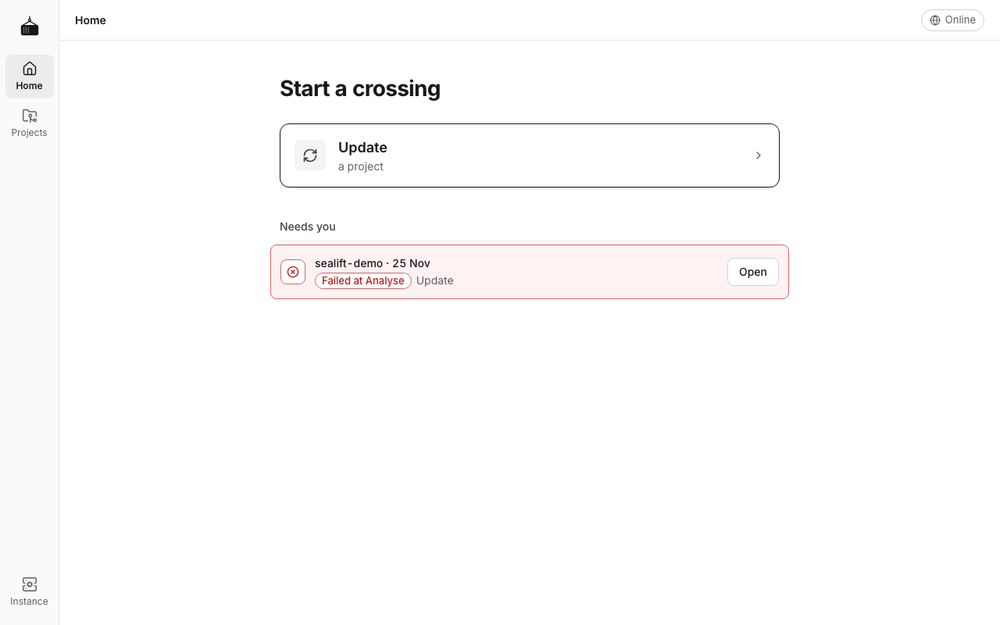
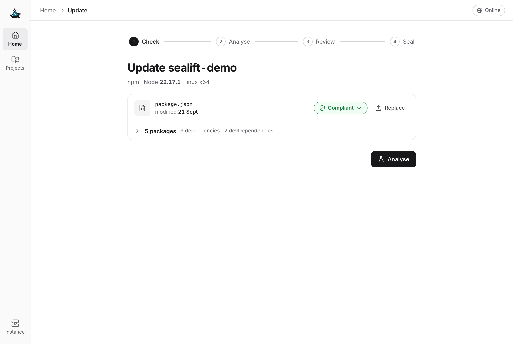
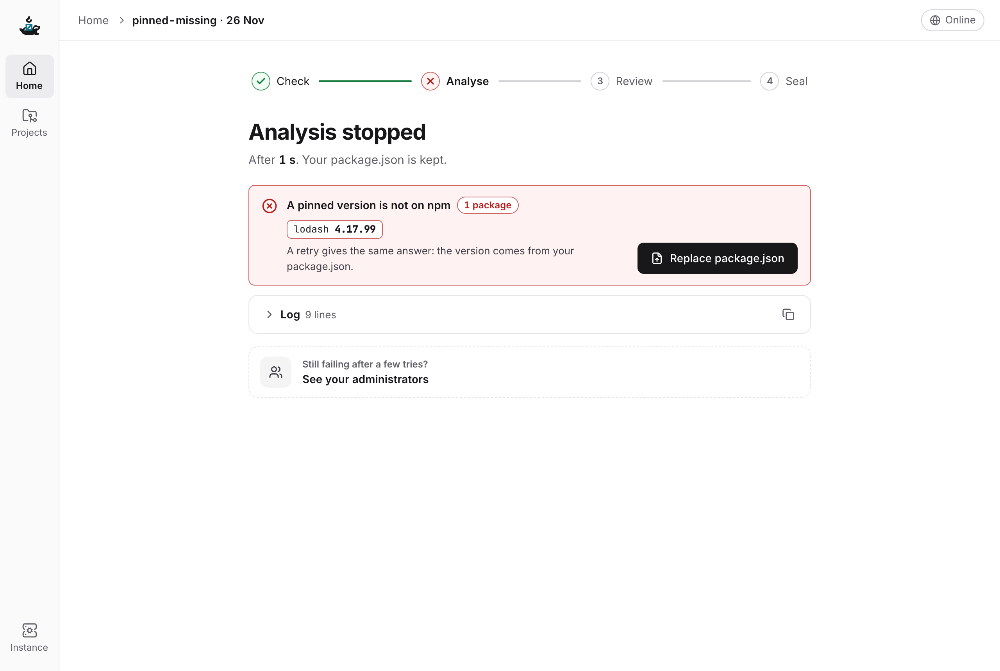
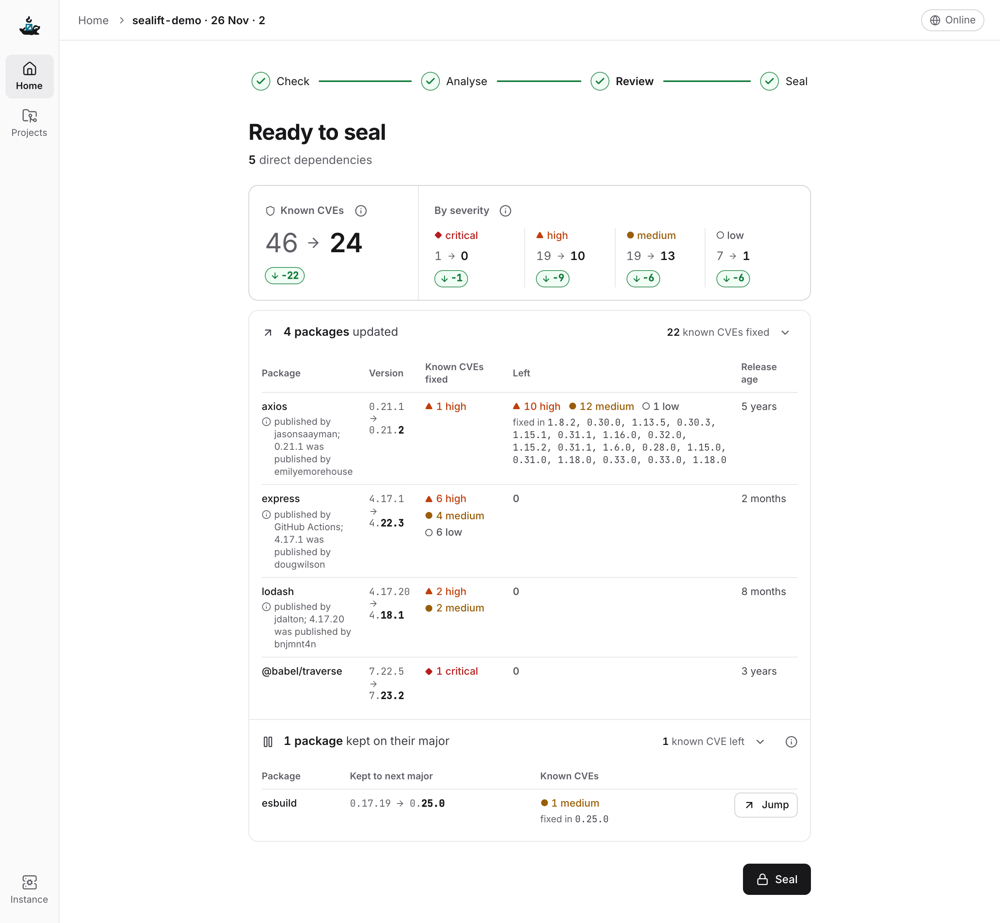
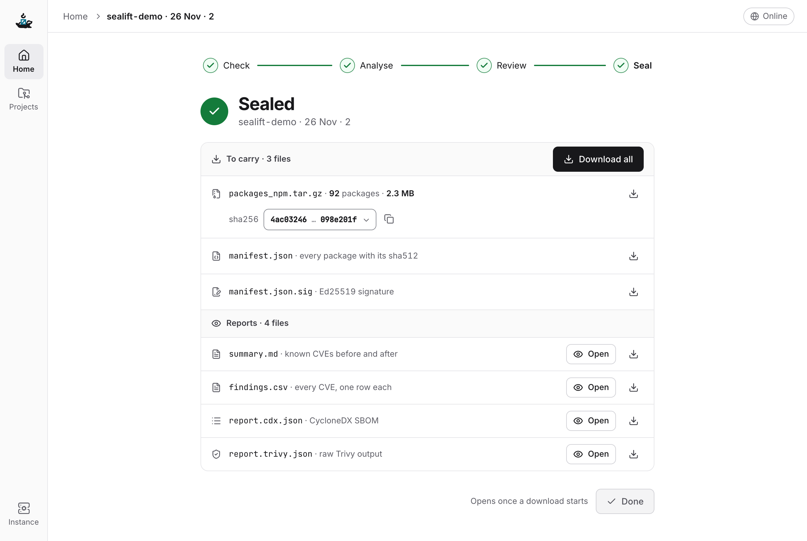

# Workflow

This page walks through each screen of the connected side, in order, with the label of every button: the frame around them, the home, Projects, then each step of a crossing. A crossing is one analysis of a project's `package.json` and the archives built from it.

## The frame

Every screen but the preparing one sits in the same frame. The sidebar on the left holds the places, **Home** and **Projects**, and **Instance** at its foot. The current place is highlighted. The top bar holds the breadcrumb, such as Home, then the crossing's name, and the side label on the right, a globe with `Online`. The deployment's brand can rename the side and replace the mark at the top of the sidebar: [Settings](settings.md#brand) lists its keys. **Skip to content**, the first stop of the keyboard, jumps past the sidebar.

A crossing is named after its project and the day its analysis started, such as `sealift-demo · 25 Nov`. A second analysis of the same project on the same day reads `sealift-demo · 25 Nov · 2`.

The step bar at the top of a session shows Drop, Analyse, Review and Export. A finished step shows a check mark and opens again on a click. A running step shows a spinner, a failed one a cross.

## Preparing

While the instance prepares, the home shows Preparing this instance, with the count of items ready. sealift prepares each item on its own at start, and the screen has no button:

| Item | Where it comes from |
| --- | --- |
| Trivy and its version | `github.com/aquasecurity/trivy`, the release the binary pins, checked against the sha256 built into sealift |
| CVE database | `mirror.gcr.io`, updated every six hours upstream; sealift refreshes it before each analysis |
| Signing key | sealift: an Ed25519 key it generated for this volume, shown with its public key sha256 |
| pnpm and its version | the npm registry, checked against the integrity it publishes. It resolves npm projects |
| uv and its version | the package index, checked against the sha256 it publishes. It resolves pip projects |

Each item reads Preparing, Ready or Failed. A failed item shows its cause and Next try in, with the time left; sealift tries again every minute. The home opens once every item is ready, with no reload. [Deployment](deployment.md#readiness) explains readiness for whoever runs the instance.

## Home

The home opens on Start a crossing, with one card, **Update** a project. Below it, two groups list the latest crossing of each project, newest first:

| Group | Holds | Row's action |
| --- | --- | --- |
| Needs you | A crossing whose review waits (Review waits), a failed one (Failed at Analyse, Failed at Seal), and a project dropped but never analysed (Not analysed yet) | **Review** for a waiting review, **Open** otherwise |
| In progress | A crossing queued (Queued), analysing (Analysing) or building its archive (Sealing) | **Open** |

A sealed or cancelled crossing leaves the home: Projects keeps it. A group shows ten rows, then **Show all**, such as Show all 12 crossings. While a crossing runs, the home reads the list again every 5 seconds, so a finished one leaves In progress by itself. Before the first crossing, In progress reads No crossing in progress.

## Update

**Update** opens Update a project, with the drop zone: Drop package.json here, and **Choose a file**. The zone repeats the rule sealift applies to every file: direct dependencies must be pinned to exact versions, such as `4.17.1`. It also names the current target.

## Projects

**Projects** lists every project with its latest crossing. The title counts them, such as `3 projects`. Each row shows the project, its ecosystem, its latest crossing and that crossing's state. From two projects on, **Latest** and **Name** order the list: newest crossing first, 15 rows and then **Show all**, such as Show all 16 projects, or by name under a heading per letter. With no project, the page reads No project yet, and **Update a project** leads to the home.

A project's page shows its name, its target and its crossings, newest first, such as `3 crossings`, or No crossing yet. A sealed crossing opens on two lists:

- To carry: the archive, `manifest.json` and `manifest.json.sig`, each with its download, and **Download all** for the three. The archive's row shows its sha256, read from the signed manifest.
- Reports: the other files of the export, such as the CycloneDX SBOM, each with **Open**, which shows it in a new tab, and its download.

An archive signed with a key this instance has since replaced reads Signed with a key this instance has replaced, then Offline refuses this archive unless it still trusts that key, with that key's sha256.

## Drop

The preview reads the file before anything runs. It shows the project name, the count of prod and dev dependencies, the pinning check and the target.

When the file breaks a rule, Pinning shows the number of problems and a list names each one. **Analyse** stays disabled until you fix the file and drop it again.

sealift reads `dependencies`, `devDependencies` and `optionalDependencies`, and refuses:

- a range or a tag instead of an exact version: `^4.17.1`, `~4.17.1`, `latest` (version must be exact, such as 1.2.3);
- a version from anywhere but the npm registry: `npm:`, `git+`, `git:`, `github:`, `file:`, `link:`, `workspace:`, `http:` or `https:` (only npm registry versions are supported);
- the fields `overrides`, `resolutions`, `pnpm.overrides` and `pnpm.patchedDependencies` (not supported);
- a file with no dependency (lists no dependency to update).

Dropping a file that an earlier session already used, byte for byte, opens You already analysed this file. It says how that session ended. **Resume that session** opens it; **Start a new session** analyses the file again with fresh data.

**Analyse 5 dependencies** starts the analysis. **Choose another file** clears the preview.

## Analysis

The analysis runs nine steps. Each shows a check mark and its duration once done.

1. Check the manifest
2. Prepare pnpm and Trivy
3. Resolve the project
4. Scan for known CVEs
5. List newer versions
6. Resolve candidate versions
7. Scan candidate versions
8. Rank and propose
9. Check the combined install

Resolve candidate versions takes most of the time: sealift installs each newer version of each dependency against the whole project. A counter shows the candidates resolved so far and the time left. You can leave the page; the session keeps running on the server.

sealift runs one job at a time. An analysis started while another analysis or an export runs reads Waiting for another job and starts on its own when that job ends. Until then, no step shows as in progress.

**Cancel** asks Cancel this analysis? before it stops. A cancelled analysis reads Analysis cancelled, with **Start it again**, whether it was running or still waiting.

When a step fails, the screen reads Analysis stopped, with the cause under What went wrong and the actions that fit:

- **Retry** starts the analysis again from the beginning, with the same file.
- **Open Instance** opens the Instance page, which shows the target and the limits in effect. The deployment's policy file sets them. A session keeps the target it started with; a new target applies to new sessions.
- **Choose another file** goes back to the drop screen.
- **Show the log** unfolds everything pnpm and Trivy wrote, with the error code the message above leaves out.

[Troubleshooting](troubleshooting.md) lists each message and its fix.

## Review

The review opens on sealift's proposal. The summary compares the CVEs today with the CVEs left with the selection, by severity, and counts the dependencies that change.

A warnings block above the summary names what the analysis could not check, such as a dependency whose registry metadata failed. Such a dependency can look clean in the list, so read the block before you confirm. The analysis checked its proposal as a whole: once you change a pick, the bar above Confirm says your selection was not installed together.

Dependencies fall into three groups:

| Group | Holds |
| --- | --- |
| To decide | A proposal with a signal worth a second look, or one that may break, which only a policy that allows other lines proposes |
| Proposed | Jumps that fix CVEs |
| Nothing to do | No CVE, or no newer version helps |

A row names the dependency, the CVEs its proposal fixes, the kind of jump, the release age, and the change from the current version to the proposed one. A click opens it:

- Current lists the CVE ids of the current version.
- The key candidates follow, each with its CVE counts by severity, its release age and its signals. The proposed one reads proposed.
- A release younger than the minimum release age reads Held back as too recent for the minimum release age, and cannot be chosen.
- **Keep the current version** leaves the dependency as it is.
- **Show all 22 newer versions** lists every candidate; **Show fewer versions** folds them again.

[How sealift chooses](how-sealift-chooses.md) explains the proposal and each signal.

The bar at the bottom counts the changes and the CVEs left. **Confirm and build the archive** starts the export with the selection.

### Reasons

A selection that takes a version outside its dependency's line, or keeps a CVE that no version fixes, needs a reason for each. The Reasons block appears above the bar with one field per reason:

- a family, or a lone dependency, the selection takes out of its line, labelled Leaves its line, with each move under it, such as `react 18.3.1 to 19.2.0`;
- a dependency whose version in the archive keeps a CVE with no known fix, labelled Keeps a CVE with no known fix, with the version and the CVE ids under it.

A dependency the selection keeps at its current version counts too: the project keeps that version on the air-gapped side. Write each reason on one line, 300 characters at most. Enter adds nothing, and a pasted line break shows its problem under the field: Keep the reason on one line, with no tab or control character.

While a field is empty or breaks that rule, **Confirm and build the archive** stays disabled, and the text before it names what is missing: 2 reasons missing: react 19, html-minifier. Past five names, the text ends with the count of the others, such as and 3 more. The reasons stay in this browser beside the selection, so a **Retry** on the export screen sends them again.

When the server still refuses, the block shows The server refused the export for its reasons, with the server's words. The deployment's policy can refuse a jump or a CVE without fix whatever the reason says; the server's words then name the policy key. [How sealift chooses](how-sealift-chooses.md#reasons) lists what asks a reason, and the signed manifest carries each one to the import side.

The review also comes in dark:

## Export

The export runs five steps: List the packages to export, Download and verify each package, Strip publishConfig, Pack the archive, Sign the manifest and write the reports. While it runs, it counts the packages downloaded, those served from the cache, and the percentage done. An export started while another job runs reads Waiting for another job, with no counters, until that job ends.

**Cancel** asks Cancel this export? before it stops. A cancelled export reads Export cancelled, with **Start the export again**, a waiting one included. A failed one reads Export failed and names the step, with **Retry** and **Choose different versions**, which returns to the review.

A finished export reads Archive ready:

- the archive card shows Sealed, the package count, the size, and the sha256 with **Copy**;
- **Download archive** downloads `packages_npm.tar.gz`;
- under the sha256, one line says which key signed the archive: this sealift's current key, a key replaced since (export again), or none, for an archive exported by 0.4.0 or earlier;
- Reports lists six files, each with **Download**: `findings.csv`, `manifest.json`, `manifest.json.sig`, `report.cdx.json`, `report.trivy.json`, `summary.md`. The import needs `manifest.json` and `manifest.json.sig` beside the archive.

**Export another selection** returns to the review to build a second archive from the same analysis. The earlier one stays below, under Earlier archive from this analysis. **Start a new session** returns home.

[The air gap](air-gap.md) covers what to do with these files.

## Instance

**Instance**, at the foot of the sidebar, opens the page that shows the readiness, the policy and the signing key, read-only. [Settings](settings.md#the-instance-page) describes it.
